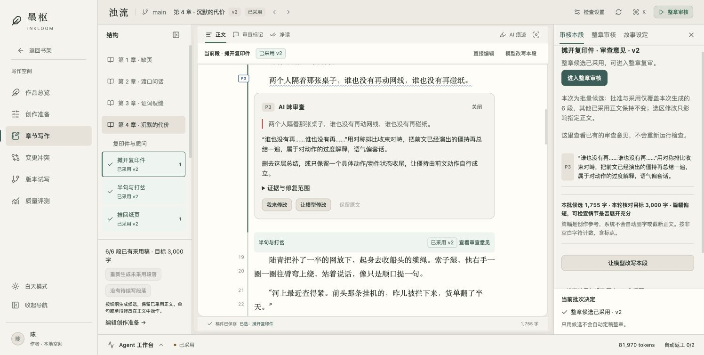
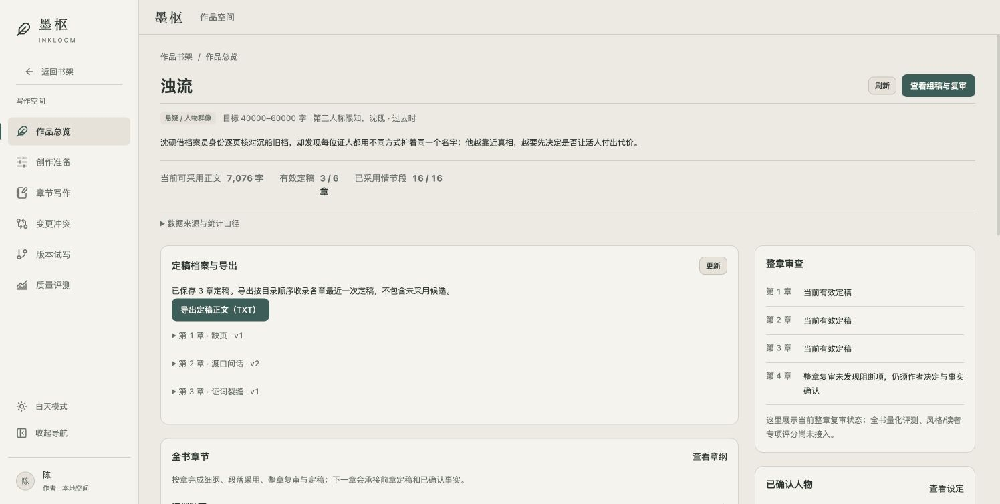
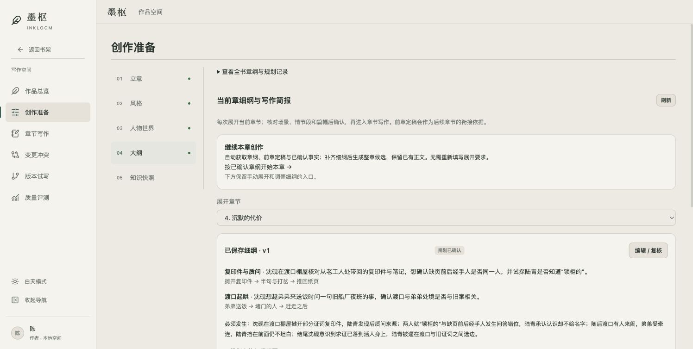
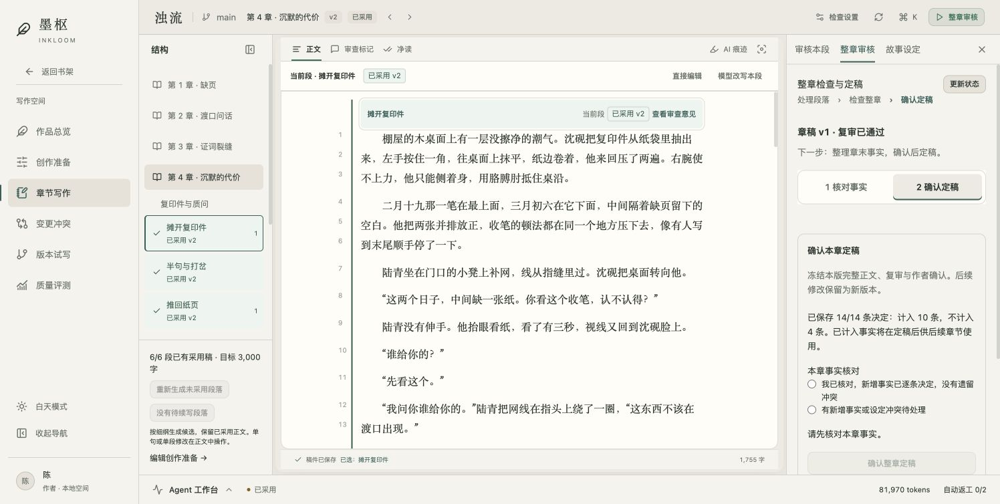
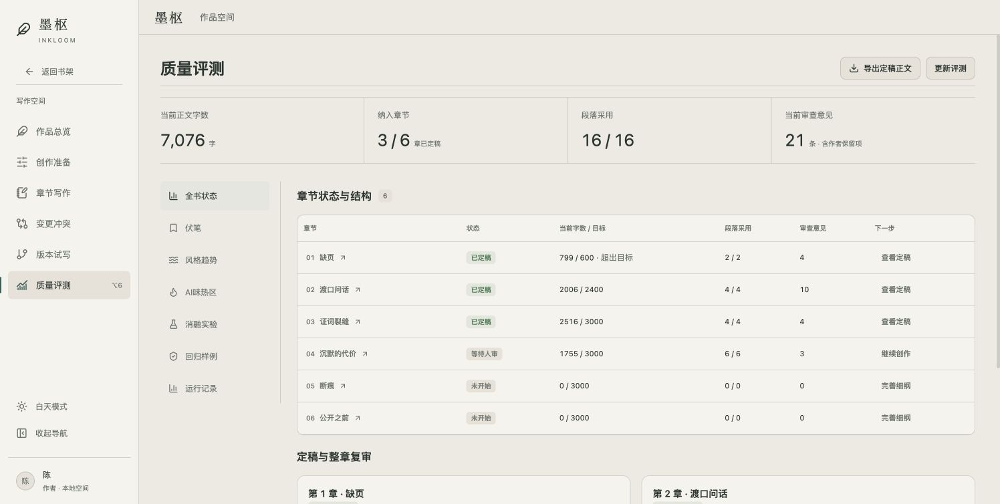
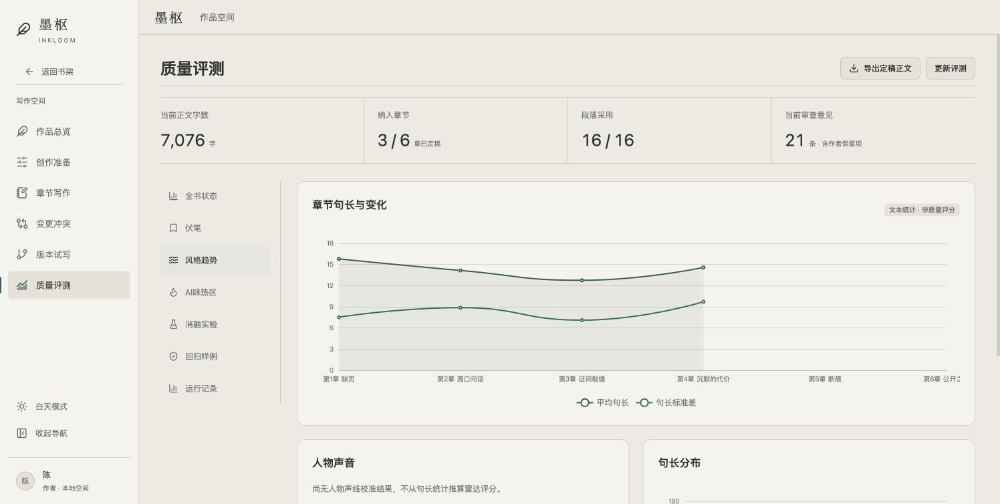
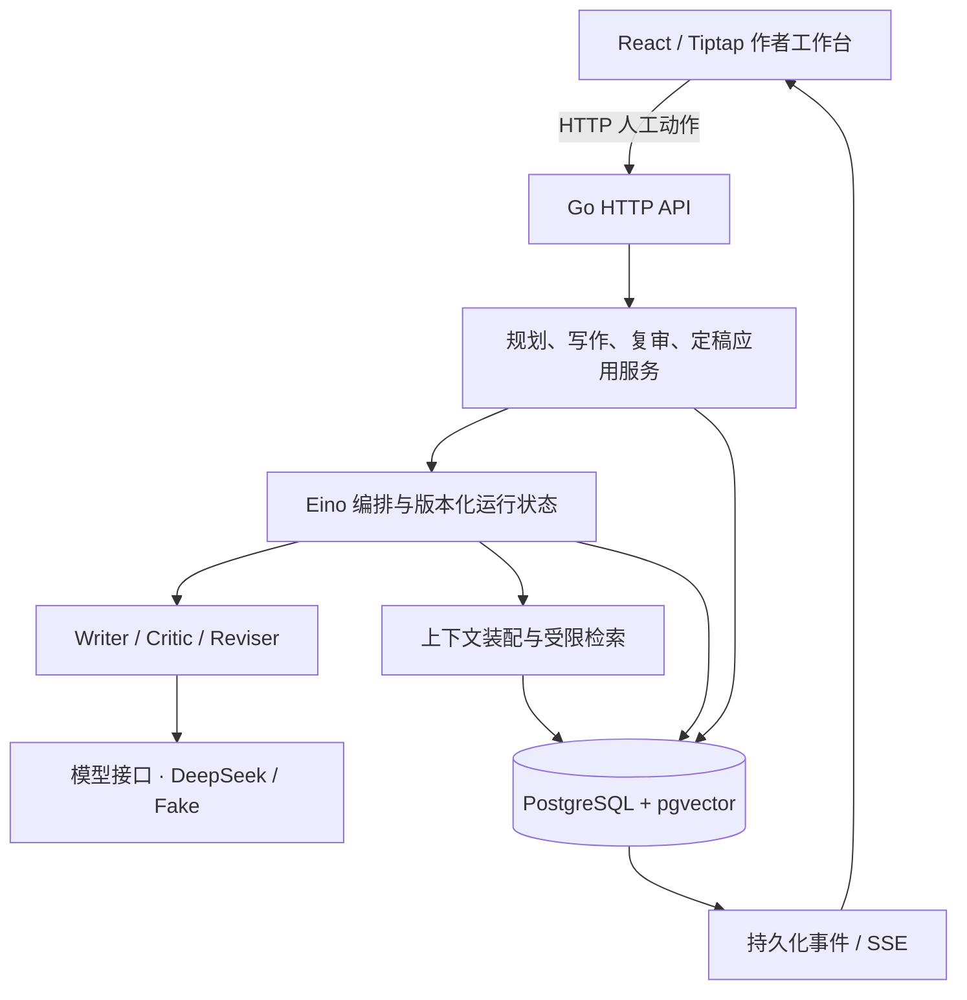

# 墨枢 Inkloom

**面向长篇叙事的多 Agent 创作工作台：从规划、生成、审改，到事实确认与跨章续写。**

Go · Eino · PostgreSQL / pgvector · React · TypeScript · Tiptap

Inkloom 将 AI 写作组织为可追溯的创作流程。模型负责提出正文和修改候选，作者在同一份稿件旁核对证据、比较差异、采用版本并确认定稿；定稿内容与已确认事实再进入后续章节的上下文。

> 当前为持续开发中的本地应用。真实创作主流程已接通，演示模式与真实数据分开。GitHub 仓库名为 **Inkroom**，产品与代码模块名为 **Inkloom**。

[核心界面](#核心界面) · [工程设计](#工程设计) · [本地运行](#本地运行) · [验证](#验证) · [实现范围](#实现范围)



## 能做什么

- **准备作品**：立意、风格试笔、人物世界、章纲、场景与情节段细纲，材料经作者确认后用于生成。
- **连续创作**：支持生成整章候选、生成单段、继续生成剩余段落；保留已采用正文。下一章承接前章定稿结尾、章纲和已确认事实。
- **在正文中审改**：一致性与语言审查定位到原文；支持直接编辑、选区改写、指定问题修订和整段改写。局部修改先看 diff，再决定是否应用。
- **作者掌握版本**：候选、采用稿、章稿和定稿分别记录；采用段落不等于整章定稿。审核状态与正文版本绑定，防止过期操作覆盖新稿。
- **维护故事事实**：章末提取事实候选，支持批量计入或排除、调整证据和人物知情范围。事实经作者决定并定稿后供后续章节使用。
- **查看质量与过程**：章节进度、审查意见、AI 味热区、句长统计、模型调用记录与定稿 TXT 导出。无真实数据的评测栏目明确显示空状态。

## 核心界面

以下截图均来自本地真实 Go / PostgreSQL 流程中的《浊流》，不是静态设计稿。截图时前三章已定稿，第四章六个情节段已采用，章末事实已处理，尚待最终定稿。仓库不包含本机数据库及其完整创作记录，新安装不会自动出现这些进度。

### 1. 作品总览

统一查看创作进度、定稿档案、人物与风格设定，并从章节状态进入下一步。



### 2. 章节规划与续写

章纲展开为场景和情节段；连续创作自动装配前章交接材料，同时保留手动调整细纲的入口。



### 3. 正文审查与作者决定

页首截图展示原文旁的问题卡、引用与修复建议。左侧按情节段导航，中央保留正文，右侧展示当前稿的审查与采用状态。已采用与待采用稿使用淡色区分；模型局部修改经过预览和显式应用。

### 4. 事实核对与整章定稿

事实决定与最终定稿分开。可批量处理剩余候选，也能逐条调整；界面汇总已计入和已排除数量，最终由作者确认章节版本。



### 5. 质量评测与文本统计

概览汇总真实采用与定稿状态，提供返回正文和导出入口；图表展示句长等可解释统计，不把它们包装成文学质量评分。



<details>
<summary>查看风格趋势与句长统计截图</summary>



</details>

## 创作流程


局部预览和应用不会自动重审整个批次；作者可集中修改后统一复检。新章默认按尽量不超过 **3000 字**的目标规划，显式章节目标优先；篇幅属于软约束，不会自动截断已有正文。

## 工程设计

| 关注点 | 当前实现 |
| --- | --- |
| Agent 编排 | Go + Eino 显式图组织 Writer、并行 Critic 与修订分支；区分模型执行与作者决策阶段，限制调用次数、token 预算与修订轮数。 |
| 结构化输出 | JSON Schema、领域校验、原文引用与版本校验组合使用；格式可修复不代表内容已通过。 |
| 有边界的编辑 | 修改请求绑定目标范围、原文和版本；局部补丁先生成预览，再校验并应用，范围外正文保留。 |
| 持久化与恢复 | PostgreSQL 保存稿本、审查、作者动作、checkpoint、模型调用与事件；操作 ID 与版本条件避免重试重复应用、旧请求覆盖新稿。 |
| 实时状态 | SSE 传递持久化运行事件并支持断线衔接；前端服务端数据缓存与本地编辑草稿分离。 |
| 上下文与 RAG | 按作品、分支、章节顺序、故事时间和 POV / 知情范围过滤材料；支持关键词与可选向量检索，保留来源和查询记录。 |
| 作者工作台 | React + Tiptap 承载正文、选区操作、原文问题标记与 diff；TanStack Query 管理服务端状态，Zustand 管理界面状态。 |
| 可追溯定稿 | 冻结完整章稿、复审、作者决定和事实来源；下一章引用已确认材料，候选内容不会直接升级为事实。 |



**实现入口：** [运行与图编排](internal/orchestration) · [模型与提示词](internal/agents) · [上下文装配](internal/contextassembly) · [检索](internal/retrieval) · [持久化与迁移](internal/storage/postgres) · [正文工作台](src/app/writing)

## 本地运行

### 环境

- Go **1.24.1+**。
- Node.js **22+** 与 pnpm **11.25.0**（版本声明见 `package.json`）。
- PostgreSQL，需安装 **pgvector** 扩展；本项目已在 PostgreSQL 17 上验证。即使关闭向量召回，数据库迁移仍需该扩展可用。
- 真实生成需要 DeepSeek API 兼容服务的可用模型与 API key；语义检索可另配智谱 embedding。不配置 embedding 时使用关键词检索。

### 1. 获取项目与依赖

```bash
git clone https://github.com/cchenxiao/Inkroom.git
cd Inkroom
pnpm install --frozen-lockfile
go mod download
cp .env.example .env.local
cp backend.env.example .env.backend.local
```

前端真实请求使用 `/go-api`，Vite 将其代理到 `127.0.0.1:8080/api`。默认的 `VITE_ENABLE_MOCK=true` 只为独立演示入口提供数据，不拦截真实 Go 接口；只使用真实流程时可在 `.env.local` 中设为 `false`。

### 2. 配置数据库与模型

```bash
createdb inkloom_learning
```

根据本机 PostgreSQL 配置修改 `.env.backend.local`：

```dotenv
# Unix socket 示例；也可使用本机实际的 PostgreSQL TCP 连接串
INKLOOM_DATABASE_URL=postgres:///inkloom_learning?host=/tmp
INKLOOM_MODEL=deepseek
DEEPSEEK_API_KEY=填写自己的密钥
DEEPSEEK_BASE_URL=https://api.deepseek.com
DEEPSEEK_MODEL=填写该服务实际可用的模型名
INKLOOM_EMBEDDER=none
```

数据库用户需有创建表与启用 `vector` 扩展的权限，或由管理员预先启用。启动时自动执行内嵌迁移；不需要手动逐个运行 SQL。密钥只放在本地环境文件，已由 `.gitignore` 排除。真实模型调用会产生供应商费用。

### 3. 启动前后端

在两个终端中分别执行：

```bash
# 终端 1：在项目根目录启动 API
go run ./cmd/inkloom -serve
```

```bash
# 终端 2：启动前端
pnpm dev
```

打开 **http://127.0.0.1:5173/library**，进入真实作品的「创作准备」。新数据库从立意、风格、人物世界、章纲和知识确认开始；真实参考流程当前使用《浊流》主分支。页面中的「新建作品」仍属独立演示流程，不能视为任意作品已接入真实后端。

### 不配置密钥也能看什么

- **前端交互演示**：保持 `VITE_ENABLE_MOCK=true`，只启动 `pnpm dev`，从书架的演示区进入，或访问 `/workspace?source=demo`。Mock 状态不代表后端成功。
- **离线编排样例**：执行下列命令，不需要数据库和 API key。Fake 是脚本化测试模型，不代表真实写作质量。

```bash
INKLOOM_MODEL=fake INKLOOM_EMBEDDER=none go run ./cmd/inkloom
INKLOOM_MODEL=fake INKLOOM_EMBEDDER=none go run ./cmd/inkloom -scenario bad-json-repaired
INKLOOM_MODEL=fake INKLOOM_EMBEDDER=none go run ./cmd/inkloom -list-scenarios
```

## 验证

```bash
# 前端单元 / 组件测试与静态检查
pnpm test
pnpm lint
pnpm build

# Go 单元测试与静态检查
go test ./...
go vet ./...

# 数据库集成测试：务必使用独立测试库
createdb inkloom_i6_test
INKLOOM_TEST_DATABASE_URL='postgres:///inkloom_i6_test?host=/tmp' go test ./...

# 浏览器端到端测试
pnpm exec playwright install chromium
pnpm test:e2e
```

未设置 `INKLOOM_TEST_DATABASE_URL` 时，数据库集成用例会跳过。E2E 默认复用本地开发服务，macOS 优先使用已安装的 Chrome。真实模型验收与脚本化测试分开记录；模型审查可能漏检，不能代替作者判断。

本次发布前验证（2026-10-19）：前端 **60 个测试文件、241 项测试**通过，lint 与生产构建通过；Go 测试及独立 PostgreSQL 集成测试通过。构建仍有图表分包超过 500 kB 的体积提示，尚未完成该项体积优化。

## 实现范围

已接通并以真实作品验证：创作准备 → 章节生成 → 正文审改与采用 → 整章复审 → 事实确认 → 定稿 → 下一章创作。真实运行、采用记录、定稿与质量页面均读取后端数据。

仍在规划或仅有演示的能力：任意新作品 / 多分支真实创作、三方合并、设定变更传播与冲突裁决、正式伏笔管理、任意运行的主动安全暂停、定稿后独立调整人物知情，以及经过校准的人物声线与消融评测。这些不作为已完成能力展示。

当前主要面向本机个人使用；公网部署需要补充认证、授权和部署配置。仓库没有附带生产数据库、API key 或托管在线演示。

## 目录与设计文档

```text
cmd/inkloom/                 CLI 与 HTTP 服务启动入口
internal/agents/             模型适配、提示词、结构化输出与审查
internal/orchestration/      Eino 图、修订与人工动作状态流转
internal/app/                规划、写作、组稿、事实与定稿用例
internal/contextassembly/    上下文装配
internal/contextlookup/      Agent 查证工具
internal/retrieval/          检索与材料可见性
internal/storage/postgres/   仓储、checkpoint 与 SQL 迁移
src/app/writing/             真实创作工作台组合层
src/features/               规划、正文、设定、评测等前端模块
e2e/                        浏览器回归用例
docs/                       设计、契约、验收与界面截图
```

- [Agent 全流程、输入输出与作者决策](docs/agent-flow-input-output.md)：理解当前流程的推荐入口。
- [真实能力接入与验收记录](docs/live-integration-tracker.md)：按时间记录实施范围与验证结果。
- [正文专项交互与编辑协议](docs/manuscript-interaction-plan.md)：选区、整段、版本对照、采用与事实批量处理。
- [前端架构](docs/frontend-architecture.md) · [后端架构设计](docs/backend-architecture.md)：后者包含目标设计，不能将全部规划视为已落地。
- [整章复审](docs/chapter-review.md) · [章末事实](docs/chapter-facts.md) · [定稿协议](docs/chapter-publication.md)。
- [早期开发记录归档](docs/development-history.md)：原 README 的阶段性记录，保留供追溯。
