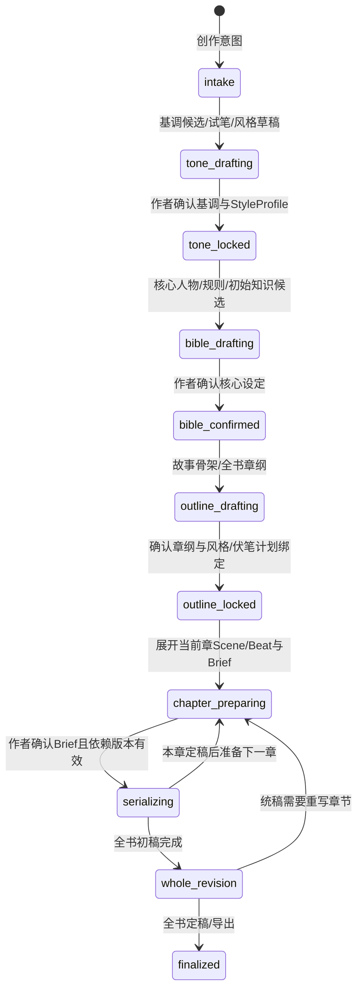
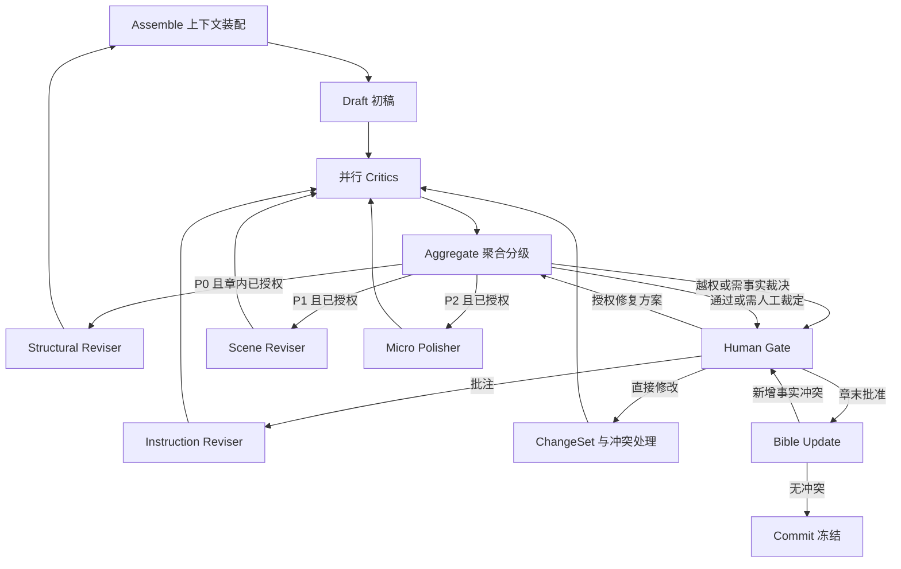
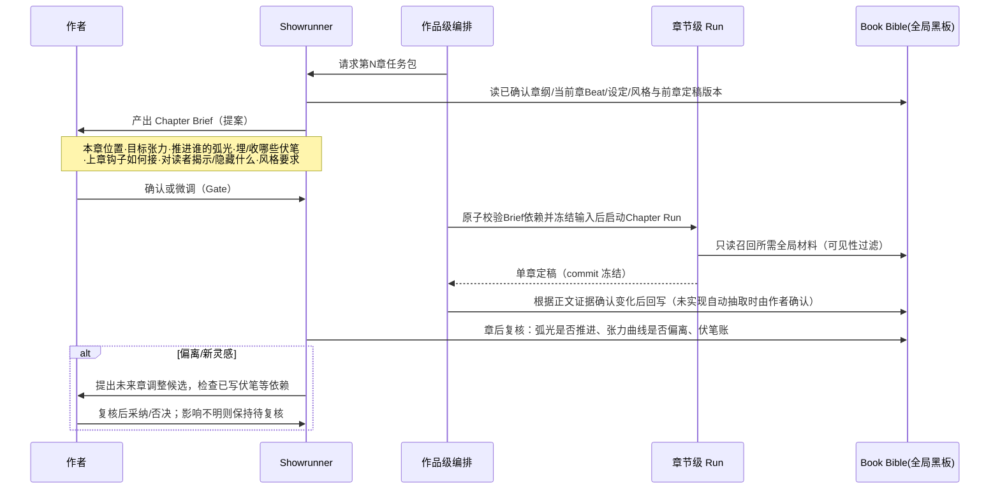

# 墨枢 Inkloom · Agent 编排与开发详解

> 这一份讲清三件事：**整个流程怎么跑（两层编排）、每个 Agent 负责什么、彼此怎么交互，以及背后的 Agent 开发技术**。
> 配套：用什么建见 [backend-architecture.md](./backend-architecture.md)，按什么顺序远见 [backend-build-plan.md](./backend-build-plan.md)，接口字段见 [frontend-api.md](./frontend-api.md)。

---

# 第一部分 · 整体流程怎么跑

## 1. 最核心的一条：Agent 之间不直接对话

本系统**不是**群聊式 multi-agent（A 对 B 说话、B 自由决定叫谁）。交互模型是 **黑板模式（Blackboard）+ 编排器路由 + 隔离上下文**：

```
Agent A 不发消息给 B；
A 只把「结构化产物 X 的某个版本」写进共享状态（Postgres + ChapterState）；
编排器按状态图决定下一步，把 X 的固定版本装进 B 的全新上下文；
B 读完只产出自己的结构化结果，再写回黑板。
```

四个理由（也是核心技术主张）：

1. **可追溯**：任意产物都能回答"谁、基于哪个输入版本、在哪一轮产出的"。
2. **防污染**：每个角色是独立消息上下文；Critic 看不到 Writer 的自我辩护，Reader Critic 才能真正"冷读"。
3. **防失控**：Agent 不能自己叫下一个 Agent、不能无限互调；路由权在确定性图与预算护栏手里。
4. **可测试**：给定输入版本，每个节点可单独用 Fake 模型驱动断言。

所有 Agent 输出都是**带 schema 的提案（proposal）**，不是终稿；经应用层校验、必要时人审，由 `commit` 冻结。一句话：**模型提议，程序/人提交。**

## 2. 两层编排：作品级稀疏强人工，章节级密集强自动

```
作品级 Book Orchestration（创意决策多，人工 Gate 密，节点稀疏）
  立意 → 定调 → 人物/世界 → 结构大纲 → ┌─ 逐章生产循环 ─┐ → 全书统稿 → 定稿
                                     │ 章前 Brief     │
                                     │   ↓            │
                                     │ 章节级 Chapter Run（下图，高度自动）
                                     │   ↓            │
                                     │ 章后复盘/回写   │
                                     └────────────────┘
        黑板 = Book Bible（全局、跨章、版本化）
```

| | 作品级 | 章节级 |
| --- | --- | --- |
| 状态 | BookState、Master Outline、Book Bible、弧光/张力曲线、伏笔总账、**StyleProfile** | ChapterState、segments、findings、draft_version |
| 节奏 | 稀疏，一个阶段一次或每章前后各一次 | 密集，一章内多节点多轮 |
| 自主度 | 低，**创意方向由人锁定**，Agent 只提案 | 中，约束内自动创作/评审/返工 |
| 黑板 | Book Bible（跨章） | 章节工作区 + 只读召回 Book Bible |
| 失败处理 | 回到作者做创意裁决 | 自动返工 2 轮，超限 escalate |

原则：**章节级追求自动化，作品级追求可控的创作意图**。越往上，人越像"作者/导演"，AI 越像"编剧团队"。

### 2.1 作品级状态机



- 三道方向确认是“基调与风格、核心设定、章纲”；每章还有 Brief 开工确认。状态图表达主路径，作者可返回任何上游编辑：新内容先成候选，采用新版本后标记相关下游 `needs_review`，重新复核才能继续。历史版本与旧 run 快照保留，不原地改写。
- **分层展开**：先全书章纲，再展开当前章 Scene/Beat。风格演化与伏笔用途先按叙事阶段描述，章纲形成后才绑定稳定章节 ID；不要求前期锁定全书所有细节。章节绑定单独版本化，引用基础风格/设定与章纲，不反写基础产物，避免双向版本依赖。
- **滚动大纲**：未来章修改也可能影响已写伏笔或已确认任务。M0 只展示已知依赖与人工复核项；牵涉已写正文、已采用的伏笔承诺或影响不明时保留旧版本，阻止受影响章节用新方案开工，待 M3 的 ChangeSet 预览/裁决后传播。不能用“只改未来章”作为自动放行依据。

> **落地状态**：这一层施工编号为 **M0.1–M0.4**，与问题级别 P0–P3 无关。M0.1=意图与基调候选；M0.2=同场景试笔与风格确认；M0.3=核心 Bible 确认；M0.4=章纲、当前章细纲与 Brief。复用已有 parse/PG/人审能力，新增规划产物的版本依赖与采用规则；当前章节后端仍为单段学习切片。详见 [开发计划 M0](./backend-build-plan.md)。

### 2.1.1 规划产物的版本与材料边界

- 每份产物保存自己的 `id/version` 与生成时的 `inputRefs[{id, version, digest}]`；采用请求携带预期版本。`confirmed` 只代表作者认可，`needs_review` 表示依赖已变化，内容类型另用 `fact/passage/plan` 表达。
- 作者确认未来计划不代表事件已发生或角色已获知。计划与角色知识分区；事实仍经项目/分支、来源版本、时间与 POV 过滤。计划落地须有正文证据与人工确认，不能仅按章节进度自动转成事实。完整时间线/信息差建模在 I12；自动抽取尚未实现时由作者补元数据。
- 上游采用新版本后，沿已有引用递归标记下游待复核并防环；这不替代 M3 的语义影响分析。作者可复核沿用内容，以新版本绑定新依赖，不强制重生成。迟到的生成结果只保留为旧输入候选，不能覆盖作者修改。
- Brief 批准与章节开工检查整组依赖。启动时原子校验并冻结输入；相关上游变化使旧批准/定稿资格失效，旧 run 输入仍不可变。章节 `draftVersion` 与规划产物版本分别管理，不能给旧结果补上新版本号后继续批准。
- 候选可在明确标注的规划/试笔上下文中比较；正式章节仅采用确认且依赖有效的材料。锚文本仅作风格样例，临时试笔不发布为正式正文或世界事实。

### 2.2 章节级状态图（M1 主轴）



完整目标含四个 Critic；**M1 只激活一致性 + AI 味两个**，但汇总接口从第一天就支持多评审结果。

### 2.3 章与章怎么交接：Chapter Brief + 章后回写

每一章不是孤立启动，而有"章前任务包"和"章后复盘"：



**Chapter Brief 是两层之间的契约**：保存章纲、当前章 Beat、Bible、StyleProfile、章节绑定与可用前章定稿的精确版本引用，以及必须发生/不能改变的事件、对读者揭示/隐藏的信息、角色可知范围。作者批准的是这组输入版本；其中任何依赖变更都需复核。当前单段切片先用其中选定 Beat，整章调度另行建设。

---

# 第二部分 · 有哪些 Agent、各自负责什么

## 3. 角色全景与自主度

| 角色 | 层级 | 类型 | 自主度 | 一句话职责 |
| --- | --- | --- | --- | --- |
| Planner / Story Architect | 作品 | 生成 | 中（人锁定） | 立意、人物、规则、三幕大纲、Beat 候选 |
| Showrunner 总编 | 作品 | 统筹 | 中（人拍板） | 守母题/主题线、调度弧光与张力、Chapter Brief、滚动大纲 |
| Tone Director 基调总监 | 作品 | 生成 | 中 | 基调方向、建立并守护 StyleProfile |
| Continuity Keeper | 作品 | 评审 | 高 | 每 3–5 章全书 sweep，抓累积走样/跨章硬伤 |
| Saga Reader | 作品 | 评审 | 高 | 跨章悬念、节奏曲线、满足感、伏笔回收体验 |
| Final Polisher | 作品 | 修订 | 中 | M5 全书风格平滑、voice 一致，保留节奏差异 |
| Context Assembler | 章 | 程序+Agent | 低-中 | 确定性装配必需材料，缺口处自主补查 |
| Draft Writer | 章 | 生成 | 中（强约束内） | 按 Beat 分块写正文，不得改锁定设定 |
| Hard Consistency Critic | 章 | 评审 | 高（判断+查证） | 事实/时间线/信息差/伏笔硬伤 |
| Style Critic | 章 | 评审 | 中 | 风格距离（程序算）+ 语义判断 |
| AI-Taste Critic | 章 | 评审 | 中 | 套话/水句/telling/句长/对白同质 |
| Reader Critic | 章 | 评审 | 高（独立主观） | 悬念、动机、节奏、想不想读下一章 |
| Aggregator | 章 | **纯程序** | 无 | 校验证据、去重分级、决定路由，争议交人 |
| Structural / Scene / Micro Reviser | 章 | 修订 | 中/中/低 | P0 回 Beat（可跨章）/ P1 场景重写 / P2 只改命中句 |
| Instruction Reviser | 章 | 修订 | 中 | 按人的批注出 patch+diff |
| Bible Updater | 章 | 抽取 | 低 | 从定稿抽事实变化提案，不裁决冲突 |
| Human Gate / Commit | — | **纯程序** | 无 | 暂停等人、版本校验、冻结提交 |

> 只有标"高/中"的判断点用模型；Aggregator、Gate、Commit、版本与预算控制是确定性代码。不同职责不需要拆成不同微服务，共用模型适配层。

## 4. 章内 Agent 逐个卡片

- **Planner**：出 Logline、核心冲突、人物 want/need/flaw/弧光/voice 候选、世界硬软规则、三幕→Chapter→Scene→Beat。全部先为候选，作者采用且依赖版本有效后成为相应约束；未来计划仍为 plan，不变成已发生事实。先章纲再展开当前章 Beat；M1 可由人导入确认材料。
- **Context Assembler**：确定性装入本章 Beat、活跃人物卡与硬规则、时间线当前位置、待回收伏笔、上一章结尾；自主部分在预算内调只读工具补查（≤3 次）。产出 `ContextBundle` + **`ContextManifest`**（用了哪些材料、来源版本、检索方式、token 估计、未纳入材料）。硬约束：章节顺序 + 故事时间/获知时点 + POV 三重可见性，作者的未来伏笔规划与角色当前可知内容**分区**传入。
- **Draft Writer**：按 Beat 逐 Segment 产出对齐正文，执行 StyleProfile 与本人 voice，给每段打结构标签（beatId/pov/charactersPresent/entitiesMentioned/foreshadowIds）。需要的事实只能查不能编；对白绑定说话人 voice，机制上避免全员同嘴。
- **Hard Consistency Critic**：抓 P0/P1——违反硬规则、时间线错乱、伏笔穿帮、角色提前获知、"认出从未见过的人"。可用只读工具取证；区分"世界事实矛盾"与"台词谎言/角色误解"（后者不是硬伤）；证据不足不下 P0。
- **Style Critic**：读正文 + 程序算好的 `StyleStats` + 目标画像，给风格偏离 Findings 与 Style Distance；语义维度（叙事距离/潜台词/感官/节奏）给分必须附原文证据；未校准特征只提示。
- **AI-Taste Critic**：五类信号——词表（嘴角勾起/一股难以言喻的…）、句法（句长方差过小、"的"字链、对仗排比）、语义（水句、cliché 比喻、把潜台词说破、信息倾倒）、统计（burstiness 偏低）、对白（过书面、跨人物声音同质）。可计算项由程序特征给，语义项由模型给证据。
- **Reader Critic**：**只给正文和阅读目标**，不给大纲/作者意图/其他 Critic 结论，保证独立冷读。输出带 rubric 的评分 + 原文证据（动机低分要对应"行为缺少依据"，不是"不够生动"）。
- **Aggregator（纯程序）**：校验每条 Finding 的引用与版本 → 按类型/段/重叠区间去重（保留不同理由）→ P0>P1>P2 排序、P3 只记录 → 选路由 structural/scene/micro/human_gate。再检查本次修复授权；涉及锁定大纲、重大结构、跨章或事实裁决先交人。**不投票**：必要 Critic 失败不能被其他通过替代；争议/证据不足交人审。
- **三个分级 Reviser**：

  | 节点 | 触发 | 动作 | 硬约束 |
  | --- | --- | --- | --- |
  | Structural Reviser | P0 | 回相关 Beat（必要时上游大纲）重写，可跨章 | 仅章内且已授权的局部修复自动执行；锁定设定/重大结构/跨章先预览并经人确认 |
  | Scene Reviser | P1 | 场景/段落级重写 | 不改其他章 |
  | Micro Polisher | P2 | 只动命中句、保语义 | 出逐句 diff，复跑风格+一致性 |
  | Instruction Reviser | 人批注 | 按批注（如"让他失态但不改事件结果"）出 patch | 服从本次指令与允许范围 |

  每次修订生成**新 draft_version**，回 Critics 复检：解决了什么、有无引入新问题。
- **Bible Updater**：定稿后增量抽新事实、人物状态/弧光、时间线事件、伏笔开闭，只产**候选**；与 Bible 比对，冲突交 Human Gate，**不自行裁决**；摘要推断不自动回写 Bible；通过后才更新关系边、触发摘要与 embedding 异步任务。
- **Human Gate / Commit（程序）**：Gate 调 Eino Interrupt，落 checkpoint、释放资源、发 `gate.waiting`；接收 `approve/redirect/instruct/inline_edit/cancel` 且**带 draftVersion**，版本不符返 409 + `version.stale`；Commit 单事务冻结相互匹配的正文/Bible/大纲版本，未确认事实绝不暴露给下一章。

## 5. 六种交互套路

1. **黑板读写**：只通过版本化产物协作，零直接对话。
2. **扇出/扇入**：4 个 Critic 并行读同一 draft_version → barrier 收齐 → Aggregator。
3. **条件路由**：按严重级别选修复范围（P0 回 Beat / P1 改场景 / P2 微改），再校验授权；越权或事实争议先到 Gate，授权后执行，章末仍须人工批准。
4. **反思闭环**：Revise → 回 Critics 复检，最多 2（可配 3）轮，超限 escalate。
5. **工具中介的记忆访问**：Agent 不直接读库，经白名单只读工具拿"带来源的结果"；写操作只产提案，Agent 不执行 SQL。
6. **人在环中断/恢复**：Interrupt 暂停 → 前端 SSE 展示 → 人决策带版本 Resume。

贯穿护栏：每节点工具 ≤3 次、结果大小上限、总调用/token/金额预算、写入按 `(run,node,round,input_version)` 幂等。

## 6. 用「第 7 章 · 夜谈」走一遍

数据：v3、in_review、返工 2/2；1 个 P0（认出从未见过的人）、2 个 P1（动机、节奏）、若干 P2（两处 AI 腔、句长太匀）；1 条冲突（人物卡=左撇子 vs 正文"右手持刀"，旁证第 3 章写左手）。

```
作者 POST /runs 第7章
 → 编排器冻结版本集、run.started
Assembler：必需材料 + 工具补查(≤3) → 写 ContextBundle + ContextManifest
Writer：读 bundle/风格/voice → segments draft v1（含两处AI腔与"右手持刀"）
 ┌─ 并行冷读同一个 v1（彼此互不可见，也不看 Writer）─┐
  一致性→ P0「认出从未见过的人」+ 左/右手矛盾
  AI味 → P2×2 + burstiness 低
  风格 → P2 句长过匀
  读者 → P1 动机/节奏（只给正文，不给大纲）
 └────────────────────────────────────────────┘
Aggregator：去重分级，最高 P0 → 检查属于章内已授权局部修复 → Structural Reviser 回 Beat
 → draft v2，revise.round(1,2)，回 Critics 复检：P0 消，余 P1/P2
 → Scene Reviser → Micro Polisher（逐句 diff）→ v3，round(2,2)
 → 复检：硬伤已解，但"左/右手"与人物卡冲突需人裁决
 → conflict.created + gate.waiting（落 checkpoint、释放协程）
作者（经 SSE 看到 Findings/冲突/2/2）：裁决冲突=改正文，可选直改/批注
 → Instruction/Micro 处理 → 复检 → approve(带版本)
BibleUpdater 抽事实候选（无新冲突）→ 回写 Bible/Graph，异步摘要+embedding
Commit 冻结 v3 匹配版本，run.finished → 可进第 8 章
```

三个关键细节：
- Writer 与所有 Critic **互不见面**，Critic 之间也不见面，只靠 v1/v2/v3 版本产物协作。
- 同一条"右手持刀"走完 **Finding → 升级 Conflict → 人裁决**，模型从不替人拍板事实，且能区分"台词谎言"与"世界事实矛盾"。
- 何时停是图强制的（2 轮），不是 Agent 自己决定；人在别处改了稿，旧审批凭版本号立即失效（409）。

---

# 第三部分 · Agent 开发技术详情

> 这部分回答"做这套东西用到哪些 Agent 开发技术"。实现落地（表结构、Run 引擎、outbox）见框架文档。

## 7. 状态分层

| 状态 | 保存内容 |
| --- | --- |
| GlobalState | project_id、Bible/Outline/Style 版本引用、章节索引、pending_changes、commit_head |
| ChapterState | chapter_id、Beat、draft_version、Segments、Findings、revise_round、gate |
| RunState | run_id、当前节点、节点输入版本、Checkpoint ID、模型与 Prompt 配置、调用用量 |

框架状态只传本次运行需要的数据和引用；正文、事实、评审、历史版本存 Postgres。**不能每次从库里分别取"最新值"拼成混合上下文**——run 启动时固定 Bible/大纲/风格等基础输入版本，正文每轮修订产生新版本，同轮 Critics 读同一正文快照。作者修改使旧候选与审批失效，不能通过补上最新版本号继续提交。

### 并行与聚合

Critics 并行读同一 `draft_version`，不直接并发改共享正文；编排器收齐本轮启用的必要评审后再合并（barrier）。某个必要 Critic 失败，本轮不能以其他 Critic 的通过代替它。Aggregator 先校验证据再去重，优先 P0，无须结构调整的局部问题不扩大重写。默认最多修订 2 轮（可配 3），初稿评审不计轮数，第二轮复检仍不过便 `escalate`，不启动第三轮修订，携历轮 diff 与未决问题进人审。

### 中断与恢复

Human Gate 持久化运行状态并释放资源；审批带 `run_id + draft_version`，版本改变旧审批失效。节点产物先保存，恢复时复用；框架可能重跑未完成节点，所以正式写入按 `(run,node,round,input_version)` 去重。模型请求已发送但结果未知时，不承诺不会重复计费，界面说明后由作者选择重试。

## 8. Prompt 与结构化输出

Prompt 分四部分：**职责与边界 / 输出 Schema / 任务要求 / 故事材料**。模板与版本独立保存；正文里出现的指令式句子按故事材料处理（防注入）。Writer 输出带 Beat 与 Segment 关联；Critic 必须返回问题类型、严重级别、位置、证据、修复建议。

```json
{
  "draft_version": 3,
  "findings": [{
    "id": "f1",
    "critic": "hard_consistency",
    "severity": "P0",
    "segment_id": "s18",
    "quote": "他认出了那个从未见过的人。",
    "evidence_refs": ["fact-7@v2"],
    "reason": "已锁定设定中，他既未见过对方，也没有其他识别依据。",
    "suggestion": "补足识别依据，或调整本场景的信息披露。",
    "repair_scope": "beat"
  }]
}
```

Go 解码后**继续**校验版本、枚举、引用是否真实存在、原文位置、修改范围——**有效 JSON ≠ 有效证据**。无法解析时最多一次结构修复；仍失败记节点失败，不能当审稿通过。模型拒答、输出截断、空响应单独处理。

## 9. 上下文工程：分层记忆与 RAG（RAG 经验的延伸，最大亮点）

| 层 | 内容 | 写入时机 / 召回方式 |
| --- | --- | --- |
| 工作记忆 | 当前 Beat、上一段结尾、活跃人物 | 每次装配直接提供 |
| Story Bible | 人物、规则、时间线、伏笔、信息差 | 已确认变化回写，按实体与时间查询 |
| Story Graph | mentions/depends/plants/resolves/appears_in/causally_before/knows | 抽取并核对，沿关联扩展证据 |
| 分层摘要 | 章摘要、卷摘要 | 定稿后生成，正文改后更新受影响摘要 |
| 向量记忆 | 历史 Segment 的 embedding | 按正式文本版本生成，语义召回 |

系统检索自己的创作产物（**self-consuming RAG**），但只把已确认事实当可靠设定；摘要中的推断不自动写回 Bible，避免错误在多轮摘要中放大。

**装配六步**：① 读固定的项目与章节版本 → ② 必装 Beat/活跃人物/硬规则/时间位置/待回收伏笔/上章结尾 → ③ 关键词+向量混合召回相关前情，合并去重后 rerank → ④ 三重可见性过滤（项目/分支/版本 + 故事时间/获知时点 + POV），受限材料不能先交给模型重排 → ⑤ 预留输出 token，按优先级裁剪，必需约束放不下就停下提示拆分 → ⑥ 落 `ContextManifest`。

**Agentic Retrieval 工具循环**：程序先装配必需材料，Assembler/一致性 Critic 针对缺口用只读工具补查——`get_character`、`query_timeline`、`get_open_foreshadows`、`search_segments`、`get_fact_evidence`。一次循环：模型给工具名+结构化参数 → Go 校验白名单/参数/项目/版本 → 执行查询 → 带源结果返回 → 模型继续或结束。每节点 ≤3 次、结果大小上限、重复无增益即停；写类工具只产提案，ReAct 不接管确定性主流程。

## 10. 多维评审、风格与定向修订

| 能力 | 实现方式 | 输出与使用 |
| --- | --- | --- |
| 风格指纹 | 句长/段长分布、对白占比、标点、固定窗口词汇统计 | StyleStats 与目标偏差 |
| 语义风格 | LLM 按量表评估叙事距离、潜台词、感官、节奏 | 带原文证据的 Findings |
| AI 味多信号 | 词表、重复句式、空泛表达、telling、信息倾倒、对白同质化 | 分项信号、热区、AI-Taste Score |
| 人物声音 | 每人绑定措辞、句式、口头习惯、表达边界（VoiceProfile） | 约束对白 + 跨章检查 |
| 定向修订 | 指定 Finding、目标 Segment、允许范围、必须保持的事实 | patch/diff + 复检 |
| 全稿统稿 | 按章/场景比较风格、voice、节奏 | 分批修订，不抹成同一句长 |

纪律：分值记录特征/权重/归一化/版本，用本项目标注样本校准阈值；**M1 只出可解释分项与暂定阈值，不把未校准总分当唯一拒绝理由**；无可靠算法的特征（潜台词密度、困惑度、声音相似度）标 disabled，不伪造。Micro-edit 后**同时**复跑风格/AI 味与受影响的一致性检查，不能只回 style_critic 就放行。

## 11. Human Gate 与变更传播

三条人工路径：

| 路径 | 链路 | 人的决定 |
| --- | --- | --- |
| 自上而下 | 改 Bible/大纲 → ChangeSet → 沿依赖找受影响对象 → stale/needs_review → 修订复检 | 先看影响，再定修复范围 |
| 自下而上 | 改正文 → diff 分纯字句/事实级 → 抽事实差异 → 与 Bible 对齐 → 更新或冲突 | 人工正文作为意图来源，牵连别处需确认 |
| 指令式 | 批注 → instruction_reviser → patch/diff → 人审 → ChangeSet | 采用、调整或放弃 |

影响分析从变动字段沿强依赖传播，弱提及进复核；遍历用已访问集合防环；模型抽取可能遗漏，**空结果不等于无影响**，覆盖不全时扩大复检并提示。Conflict 存 Bible 说法/正文说法/旁证，处理选项=改正文/改 Bible/全局统一，台词谎言与世界事实分开。顺序固定 `HumanGate → BibleUpdate → Commit`：未确认事实不进下一章；索引与摘要更新携来源版本，旧任务不覆盖新稿索引。M3 才加分支试写与历史恢复（分支独立版本与检索范围，冲突作者裁决）。

## 12. 评测、追踪与成本

- **LLM-as-Judge**：一致性/风格/阅读体验分别定义 rubric，每项要分数+原文证据+理由；规则能判的优先规则，模型只判语义。
- **消融对比**：固定故事种子，比较单 Agent / 多 Agent 无记忆 / 完整系统，再单独关记忆或关返工；同题材同篇幅同模型配置，报真实 token 与成本；多次运行、匿名、交换顺序、保留失败案例，无增益如实记录。
- **回归集**至少含：硬设定矛盾、时间线冲突、角色提前获知、伏笔遗漏、套话、正常无错文本、**角色故意撒谎**、以及修改后新引入的错误。改 Prompt/模型/检索/门禁即重跑；真实模型评测由人显式启动。
- **Trace**：一章一条 trace，每次模型/工具/检索/评审/修订/人决是子 span，记角色、Prompt/模型版本、输入产物引用、输出版本、耗时、token、路由理由、修复的 Finding；不存隐藏思维链。Go 用 OpenTelemetry 导出 Langfuse。
- **成本护栏**：每 Run 配总调用次数与 token/金额上限，调用前检查余额，工具循环/结构修复/重试都计入；Critics 受限并发。M4 再比较强模型做规划、便宜模型做初稿的总费用，不预设便宜一定省。

## 13. 作品基调（Tone/Style）怎么确定

- **基调 Tone** = 读者情绪体验（冷峻/阴郁/荒诞/温柔/压迫），主观、人定；**文风 Style** = 实现它的语言手段（句长、对白比、用词、标点、节奏），可统计。**StyleProfile 是把主观基调翻译成可执行可测量约束的契约。**
- **确认过程**：采集意图 → Tone Director 给 **2–3 个并列方向** → 作者选定/修改 → 用同一临时 Beat 写 2 个试笔样本 → 作者圈点或编辑样本 → 确认 StyleProfile 与 few-shot 锚文本。有满意范文时可直接采用，跳过试笔。统计特征可从文本提取，目标区间是建议；选中样本不等于阈值已校准，不自动反推未经验证的评分权重。临时 Beat 与样本文字不进入正式故事事实库。
- **三层约束**：叙述规则（人称/POV/时态及允许的章场切换）/ 软目标（句长区间、用词，未校准仅提示）/ `styleArc`（计划内基调演化）。早期 styleArc 按叙事阶段表达，章纲确认时才绑定章节。明确违反已确认硬约束才阻断，合法视角切换不误判。M5 统稿保留动作戏/抒情戏差异；基调修改先标记已知依赖待复核，完整全书影响分析在 M3。

## 14. M1 范围与 Agent 技术学习重点

M1 单章闭环：Beat + 基础设定 + 最小 StyleProfile → 初稿 → 一致性 + AI 味两个 Critic → 聚合分级 → 自动返工 → 人审 → 定稿。

- **用到的 Agent 技术**：结构化输出与校验、Graph/State、并行聚合、条件边、有限循环（反思）、Checkpoint/HITL。
- **暂不做**：真实 Planner（人工导入大纲）、pgvector 混合检索、Style/Reader Critic 完整版、ChangeSet 影响传播、分支、评测面板——但它们的接口与字段从第一天预留（StyleProfile、伏笔/弧光字段、多评审汇总接口），后期是"接上能力"而非回头改模型。
- **M1 验收**：一章自动流转；超 2 轮进人审；重启可恢复等待审核；能看 diff、证据、调用记录。

后续里程碑：M2 跨章记忆（工具调用/上下文预算/分层记忆/Agentic RAG/信息抽取）→ M3 人机共创（状态同步/依赖传播/HITL/带来源记忆更新）→ M4 评测与成本（Agent Eval/可观测/多模型）→ M5 打磨（多视角评审/风格控制/全书统稿）。

---

# 第四部分 · 端到端具体示例（以《浊流》为例）

> 前三部分讲规则，这一部分全部用具体输入输出走一遍，回答：前期人要给什么、系统产出什么、每份东西给谁用；以及一章写完后怎么评审、怎么改、自动还是人确认、会不会整章重写。

## 15. 作品级：用户前期提供什么

在准备页（/prepare）填写，分必填和选填。**M1 时手填/导入；M0.1–M0.4 起升级为基调候选与试笔 → 核心设定 → 全书章纲 → 当前章细纲与 Brief。** 一句 logline 可开始探索；其他缺省项由系统给建议并明确标注待确认，不能静默成为约束。以下区分探索入口与方向确认所需信息；已有材料可从对应阶段导入，不强制重走向导。

| 项 | 必填/选填 | 《浊流》示例 |
| --- | --- | --- |
| 一句话立意 Logline | 必填 | "洪水围困的江城，一名理赔员在核查一桩死亡赔付时，发现死者可能正是多年前害他家破人亡、却被认定已死的人。" |
| 类型 / 目标篇幅 | 探索时可空；基调与风格锁定前确认 | 悬疑 / 中篇，约 4–5 万字，12 章 |
| POV / 时态 | 探索时可空；叙述规则在风格锁定前确认，具体人物在设定/章纲绑定 | 第三人称限制视角，主视角沈砚，过去时；个别章节切陆青视角 |
| 核心冲突 / 结局走向 | 强烈建议 | 外部：查真相；内部：他要不要为复仇毁掉眼前无辜者的生活。结局偏冷，真相揭开但代价沉重 |
| 情绪关键词 | 选填 | 压抑、潮湿、克制、寒意；不要爽感、不要金句堆砌 |
| 对标作品 / 范文片段 | 选填（审美锚） | 贴一段自己喜欢的冷峻悬疑文字（约 500–1000 字），没有也可以 |
| 自己过去的文字 | 选填 | 用于贴近作者本人语感 |
| 已有大纲 / 人物 / 世界观 | 有则导入 | 哪怕只有几个人名和一个结尾都行，系统补全候选、人来锁定 |
| 禁用表达 | 选填 | "嘴角勾起""一股难以言喻的""不禁""深邃的眼眸" |

> 关键认知：**用户不需要先想清楚一切**。最少只给 Logline 即可开始，其余由 Planner/Tone Director 出候选；在对应阶段确认必要输入后才能进入正式创作。人给的是"方向和取舍"，不是完整设定。

## 16. 作品级：每一步产出什么、有什么用

### 16.1 基调方向：系统给 2–3 个**并列**候选（不是一个）

示例（作者只给了上面的 Logline + "压抑潮湿克制"）：

- **方向 A · 冷峻白描**：远距离叙事、白描、低形容词、短对白、像理赔报告一样冷。禁忌味道：抒情泛滥、内心独白过载。
- **方向 B · 潮湿阴郁**：近距离、多雨水与身体感官、长句缠绕、内心独白密，压迫感来自环境。禁忌味道：爽利、明快、吐槽。
- **方向 C · 黑色荒诞**：克制中突梯，对话带机锋，节奏跳切。禁忌味道：苦情、煽情。

作者选 **B**，并批注"对白再少一点，别文艺"。这一步保存方向选择，随后在同一临时场景上试笔或选用已有范文，再确认 StyleProfile；仅选基调还不能启动正式章节。

### 16.2 StyleProfile：把"味道"翻译成可执行可测量的契约（系统产出，人锁定）

```yaml
硬约束: { person: 第三人称, pov: 沈砚(主)/陆青(已批准章), tense: 过去时 } # 按章绑定，禁止未授权切换
软目标:                                                       # 区间，允许波动，未校准只提示
  平均句长: 14–20 字
  长短句突发度 burstiness: 0.55–0.8
  对话占比: 0.20–0.32
  段落长度: 偏短，单段 ≤ 4 行居多
  感官密度: 雨水/触感/光线 中高
  用词层级: 口语化、去辞藻，形容词 ≤ 每百字 6 个
bannedLexicon: [嘴角勾起, 一股难以言喻的, 不禁, 深邃的眼眸, 空气仿佛凝固]
styleArc:                                          # 章纲确认后的展示；存储绑定稳定章节ID
  - 第1–6章: 克制冷静
  - 第7–9章: 节奏收紧、短句增多
  - 第10–12章: 真相段允许一次情绪爆裂，之后迅速收回冷调
锚文本: [作者选定或修改的试笔/已有范文片段]                    # 同时是 few-shot 例子
version: 1, locked: true, 阈值校准状态: 未校准(M1 仅提示)
```

上例展示基础 StyleProfile 与章纲绑定合并后的阅读视图，存储时分别版本化；早期只写“真相逼近阶段收紧”等阶段要求，不提前引用不存在的章节。章号为可变展示序号，版本引用绑定稳定 ID。

**谁用它**：Writer 写作约束；Style Critic 检查风格；AI-Taste Critic 查禁词与句长；Final Polisher 统稿。明确违反已确认叙述规则可阻断；未校准软目标只提示，不因作者选中样本就升级为自动返工门禁。

### 16.3 Story Bible：系统补全人物/规则/时间线候选，人逐条锁定

先确认核心人物、规则与初始知识；弧光终点、未来事件和伏笔用途放计划区。以下是第 7 章已有正文依据的状态示例，规划阶段不能把拟定的 `arc_stage@ch7` 或 `knows@ch7` 当作已经发生/获知的事实：

人物卡示例（沈砚）：

```yaml
name: 沈砚   aliases: [沈先生, 小沈(旧识用)]
want: 尽快结案拿到理赔款应付家里债务          # 表层目标
need: 放下以"真相/复仇"为名的自我毁灭        # 内在需求（他自己没意识到）
flaw: 用冷静和程序正义回避情感，会为了求证伤害亲近的人
arc_stage@ch7: 从"只按规章"转向"开始主动越界"
hard_traits:                                  # 不可矛盾的硬设定
  - 左撇子
  - 对青霉素过敏
  - 不识水性（洪水是他的软肋）
voice: { 用词: 短句、少形容词、爱用公文式措辞, 口头禅: "按流程。", 信息密度: 高, 情绪外露: 极低 }
knows@ch7: [已怀疑死者身份, 不知铜扣暗号含义, 不知陆青与其父关系]
```

**谁用它**：Assembler 装配、Writer（绑定 voice、不能让他知道他不该知道的事）、一致性 Critic（对硬特质/knows 查硬伤）、Reader（判断动机是否成立）。其余如世界规则（"汛期封桥，晚 8 点后两岸不通"）、时间线、伏笔台账、信息差矩阵同理。

### 16.4 大纲：故事骨架 → 全书章纲 → 当前章 Scene / Beat

三幕是可调整的默认结构。先确认章纲、风格阶段和伏笔计划的章节绑定，再逐章展开细纲；未来章细节可留空。引用按稳定 ID 校验，故事时间与阅读顺序分别处理，不能用章号大小直接否定倒叙。

以第 7 章为例（不是长篇散文大纲，是可执行节拍）：

```
第7章 夜谈（目标 3500–4200 字，POV 沈砚，基调：收紧）
 场1 雨夜到访
   beat 7-1 沈砚上门核实不在场证明，对方刻意回避时间
   beat 7-2 他注意到门后挂着一件不可能属于这户人家的旧工装
 场2 摊牌
   beat 7-3 用铜扣试探，对方失言，暴露其认识死者
   beat 7-4 沈砚压上证据，对方反咬他"你不就是想看他死吗"（动机施压）
 场3 退让
   beat 7-5 沈砚失态（对应读者 P1 要修的动机点）但没拿到结论，雨更大了
本章必须：埋"工装"伏笔(F-12)；不揭示铜扣全部含义；推进沈砚弧光 1 格
```

**谁用它**：Beat 是 Writer 的直接输入和"对齐标尺"；也是 P0 回退时的重写起点。

### 16.5 Chapter Brief：作品级 → 章节级的交接契约（每章开工前，人确认）

以下为作者可读摘要；实际产物还保存章纲、Beat、Bible、StyleProfile、章节绑定与前章定稿的版本引用及依赖状态。对读者隐藏什么与角色知道什么分别标记，不把作者全书计划直接当角色知识。

```
第7章任务包：在三幕中处于"真相逼近的第一次正面接触"；目标张力 7/10。
推进：沈砚弧光（开始越界）。埋 F-12 工装；不回收 F-07 铜扣（留到第 9 章）。
承接：上章结尾他记下了门牌号；本章开场要在 2 段内接上雨景。
对读者：揭示"死者可能被庇护"，隐藏"庇护者与陆家关系"。
风格：进入 styleArc 收紧段，对白更少、句子更短。
```

**用途地图（产物 → 消费者）**：StyleProfile→Writer/Style/AI味；人物硬特质+knows→一致性；伏笔账→Assembler 与一致性；Beat/ Brief→Writer 与回退点；信息差→Reader 与一致性（防提前剧透/角色全知）。

### 16.6 创作质量辅助：目标、参考与检查建议

系统帮助作者发现选择、遗漏与表达上的偏差。创作目标由系统提出候选、作者采用；检查结果必须引用具体材料，不能把一种写作方法变成所有作品的合格标准。好奇、悬念、人物关怀是常见的吸引力来源，语言趣味、氛围、观察与情感积累也可以支撑阅读。

**A. 可选设计维度（按作品需要启用，不增加必填表单）**

| 维度 | 保存什么 | 如何辅助 | 执行边界 |
|---|---|---|---|
| 期待与回应 | 区分人物愿望/宣告、威胁、伏笔和作者确认的读者期待；记录开出位置、计划回应及实际正文依据 | 提示可能遗漏的回应，允许失败、转化、有意留白或取消并说明理由 | 人物目标未实现不等于作品失约；默认 P3，不能据台账未关闭判 P0 |
| 张力与情绪 | 作者希望的舒缓/蓄势/紧张等走向，与模型对正文的估计分开保存 | 比较目标与实际表达，提出节奏调整选项 | 不强制中点反转、持续升级或张弛交替；估计附依据、标未校准，不称“实测值” |
| 人物抉择 | 行动动机、可选道路、选择代价与弧光关联 | 检查行动是否有可理解的原因和后果 | want/need 两难只是可选方法；不要求每次选择都有损失，不因全胜自动判错 |
| 人物关系 | 双方需求、阻力、隐瞒、信任/敌意/亏欠的变化及依据 | 提供对抗、合作、试探、亲密与修复关系的场景选项 | 优先文字描述，不伪造关系分值；关系未改变不直接判灌水 |
| 场景功能与收尾 | 作者选定的场景目的，可包含情节、人物、信息、氛围、日常质感、情绪消化；记录开篇/收尾意图 | 指出与目的不符或重复的信息，并说明可能保留的作用 | “前 300 字异常”“每章悬念结尾”只作可选模板，不默认报警或建议删除安静场景 |
| 文笔与声音 | 叙事距离、感官选择、对白策略、锚文本、正反例及词句统计 | 同场景试笔、原文定位、局部候选对比；盲听识人作为可选样本评测 | show-don't-tell 等只作方法参考；声音评测注明样本、上下文与判断来源，不逐句阻断 |
| 幽默 | 作者选择的幽默来源、分寸、适用情境；可来自人物、关系、叙述观察、情境错位或黑色幽默 | 按需生成试笔/对白候选，提示与人物或场景意图冲突的表达 | 不强塞笑话、不限定为缓冲场、不设笑点配额或幽默达标分数；默认 P3 |
| 沉浸与意象 | 地点感官参考、意象用途与复现计划；时间/物理事实仍归既有 Bible | 按当前场景需要选取细节，核对计划与正文的联系 | 不要求重访必复现或“出现→误解→点题”；物理判断依据本作已确认规则，不能将常识猜测直接判 P0 |

**B. 类型模板（GenrePack）：可选择、可融合、可退出**

类型在 M0.1 作为作者输入或待确认建议保存。《浊流》仅为演示作品。GenrePack 是版本化的数据配置，提供设计维度、Brief 提示与检查模板的默认建议，不是必须遵守的叙事公式；前期无需建设插件运行框架。

- 作者可以启用、关闭或调整创作模板。融合类型时，对互相冲突的规则逐项选择或暂不启用，不简单叠加；未处理的冲突不注入相互矛盾的写作指令。
- 类型模板不能绕过事实版本、角色知情范围、并发保护等基础约束。将创作偏好设为硬约束须单独明确确认适用范围和例外，不能因选中一个类型包就自动升级为门禁。
- 保存 `packId/version`、已启用规则及作者覆盖项；生成时冻结有效配置及摘要，与 PromptVersion 分开引用。包更新不静默改变已确认作品或历史 run；作者采用更新后，按已有依赖规则标记受影响产物待复核。
- 爱情、科幻奇幻、成长群像、恐怖等可逐步增加模板；不在 M0 一次建设全部检查器。

**公平推理是可选模板，不等于全部悬疑作品的规则：**

- 记录解谜依赖、线索呈现位置及揭晓依据。检查采用正文的阅读顺序（稳定章节 ID 对应的顺序、段落与文本位置），支持同章先埋后揭；故事发生时间另存，不拿故事时间代替读者看到的先后。
- 线索 ID 存在只能证明登记，不能证明正文充分呈现；ID 缺失或检索未命中也不能证明未写。系统可确定性检查引用有效性与显式顺序；“读者是否获得足够线索”“误导是否公平”仍需结合正文语义与作者判断。默认输出 P3“可能缺少前置依据”，证据不足时明确无法判断，不自动判“真相空降”。
- 规划中的揭示位置与正文已呈现的证据分开保存，计划确认不代表读者已经知晓。红鲱鱼可单独标记并附事后解释，但不把“回看合理”伪装为确定性结论。
- **读者与角色分别取材**：读者审查使用截至当前阅读位置的正文证据与披露记录；角色审查沿用 I10/I12 的 POV、来源时间与获知范围。I12 已有 reader 主体，但现有 `knowledge.Records` 检索投影排除了读者记录，不能直接复用角色检索来证明读者已看见。读者证据视图尚需单独接入，不将未来揭示当作当前阅读证据。

**C. 执行与数据边界**

- **近期新增的审美意见统一为 P3、非阻断，`requiresHuman=false`**，作者可以忽略，不进入自动返工或定稿阻断。采用意见后形成带当前版本、范围与明确意图的人工修改指令；超出授权或影响既有正文时仍走既有变更流程。事实裁决仍保留原有人工门禁。
- 现有 P1/P2 分别参与场景/句级修订路由，不能新增“P2 但仅建议”的隐含含义。本节不重定义既有 AI-Taste 等评审规则；未来若需要表示建议的重要程度，再单独设计重要程度、阻断与自动修改权限。
- **硬门禁条件**：违反明确确认且适用的硬约束，并有当前版本可定位的充分证据，且不存在未处理的例外或来源冲突，才进入既有事实一致性分级；并非所有违约都为 P0，仍按影响与修复范围分级。审美目标即使被作者采用也不自动成为硬约束。未回应、线索不足、自然常识推断默认不得直接升级；元数据引用错误先作为数据校验错误处理。
- **三类结果分开**：程序统计保存算法版本、范围、计数与定位；模型估计保存模型/prompt 版本、原文依据与未校准标识；作者目标保存期望和适用范围。词频与显式引用可统计；抽象程度、视角距离、张力、幽默效果不能仅凭关键词扫描宣称确定性。未实现或不可靠的量化项不展示分数。
- **计划与观察分开**：采用的创作目标沿用 candidate→confirmed 和版本依赖；正文观察/检查结果绑定稿本版本，过期后须重评，不能回写成既定事实或覆盖作者目标。Brief 只装配当前任务需要的目标、参考和规则，不整包灌入全部账本；作者视角计划与角色知识分区。
- **影响边界**：M0 只处理已知依赖与待复核标记；影响已写正文、已采用承诺或影响不明时，保留旧版本并暂停受影响任务采用新方案。完整语义影响分析与传播留在 M3，不宣称当前已实现。
- **能力状态**：现有 hard_consistency 支持既有事实查证，不代表公平线索、期待回收或全书时间物理检查已实现；现有 ai_taste 不代表已具备全部文笔检查。style/reader 与新增戏剧、幽默、读者线索检查按后续阶段接入，未实现前标“规划中”，不生成伪造结论。

**D. 复用产物与分步建设**

- 不新建十套独立账本或十个 Agent。期待/线索扩展既有伏笔台账，关系/抉择放人物关系与场景计划，文笔/幽默/感官参考扩展 StyleProfile，场景功能与节奏放章纲及 Brief；事实与作者计划继续分区，检查结果作为稿本相关的派生数据保存。
- M0.1a 先保存类型与可选模板选择，不要求作者配置规则；所选类型应影响方向候选和后续试笔，未选类型不静默默认悬疑。M0.2 用样本确认文笔、对白和可选幽默；M0.3–M0.4 只补当前作品需要的关系、期待与场景目标。质量检查器、读者证据视图按小步另行建设，不作为 M0.1a 前置条件。
- 当前 `internal/agents/prompts/writer.v1.tmpl`、`writer.v2.tmpl` 含固定悬疑/推理措辞。接入真实规划输入时新增提示词版本，让 Writer/Reviser/Critic 接收已确认类型与适用规则；保留旧提示词版本以追溯历史，不直接改写历史契约。规则配置版本独立冻结。《浊流》的 `seed.ts` 类型作为 demo 数据可以保留，不作为真实作品的默认类型或配置来源。

### 16.7 质量上限回路：防错之外，怎么让稿子更好看

现有链路擅长守下限——不串设定、不泄底、不蹦 AI 腔、关键处停人。但"不出错"不等于"想往下翻"。本节补四条只在需要时启用的"提上限"回路，沿用全文既有约束：候选→人确认、版本冻结、fail-closed 可见性、审美意见默认 P3 不阻断、不伪造分数。它们是规划型发散-收敛（M0）与变更传播（M3）在正文层的复用，不新增自由群聊、不新增硬门禁。

**① 模拟读者：一双零上帝视角的眼睛**

新增一个 Reader 视角，和现有两个"看得见规划/底牌"的编辑型 Critic 分开。它只拿到**读者证据视图**：按稳定章节阅读顺序、截止当前阅读位置、正文里确已写给读者看过的内容；不喂大纲、Brief、人物档、未来揭示、§16.6 的作者台账。它只回答读者问题（哪段想往下翻/哪段划走、哪没看懂、信息是提前猜到还是到点才知道、章尾想不想续读），不做事实裁决。

- 这正是 §16.6-B 已标注的缝隙：I12 有 reader 主体，但 `knowledge.Records` 检索投影排除了读者记录。读者证据视图要**单独按阅读顺序构建**，不能复用角色 POV 检索来证明"读者已看见"；未来揭示不得当作当前阅读证据。
- 产出是带正文定位的读者反应估计，属模型估计类：标模型/prompt 版本与"未校准"，默认 P3、`requiresHuman=false`，不进自动返工、不阻断定稿。
- 与事实 Critic 隔离上下文并行，避免读者直觉污染硬一致性结论。

**② 重场戏多版本：择优而非一稿改到死**

M0 在规划层给候选，正文层目前是单稿+打补丁，只能"补错"到不了"择优"。对作者在章纲/Brief 标记的**重场戏**（抉择点、高潮、章尾钩子等，直接引用 §16.6 已有标记，不另造判定规则），Writer 一次产出 2–3 个走法不同的并列正文候选（如：当场失态 / 压着不动 / 反手试探），人选定一个，或指定"取 A 的情绪 + C 的收尾"再合成。普通过场 beat 仍单稿，避免 token 与节奏失控。

- 复用 M0 的 proposal+selection 表与人工锁定闸门，候选下沉到正文；每个候选共享同一冻结 Brief 与输入版本，差异只在表达与走法。
- 多版本只在作者标记的重场戏触发，不默认全书每 beat 多写。

**③ 写作现场发现回流：让好东西反向更新规划**

强规划会压住"写到那场戏才长出来的好东西"。给 Writer 一个**只报不改**的出口：随稿提交结构化"现场观察"（某人物自然长出的动作/口吻、哪条原定情节写着别扭），不直接改正文之外的任何产物。Showrunner 评估后产出"大纲/人物档修订**建议候选**"，人确认才锁定，再沿 M3 的依赖图影响传播，重算受影响后续 beat 的 Brief。

- 观察绑定稿本版本，是派生数据不是事实；未被采纳不回写、不阻塞。
- 这条把 ChangeSet/影响传播从"改设定→传播到正文"反向用成"正文发现→传播回规划"，让线性流水线变成带反馈环的协作网；完整语义传播依赖 M3，未实现前只登记待复核、不自动改后续。

**④ 定稿后风格回采 + 交稿意图（两个轻量增强）**

- **交稿意图**：Writer 交稿时附极短结构化意图（本场想让读者感到什么、故意留白/延后揭示什么），对齐 Brief 的 reveal/withhold。评审据此区分"故意留白"与"没写清"，减少冤枉返工；限长、不得写成自我辩护，也不豁免真实问题。
- **风格回采**：仅从**作者已确认定稿**的章节提炼"这本书已经形成的声音"（典型句式、复现意象、人物口吻指纹），增量沉淀进 StyleProfile，供后续 Writer 参考。不从未定稿/被打回稿采，避免把偶发语病固化；回采结果是候选，人确认后才并入版本化 StyleProfile。

**与评测的关系**：①②天然是 M4 消融的自变量——对比有/无读者视角、单稿/多版本在"人工打回点数、章尾续读意愿"上的差异，用数据决定是否默认开启，而不是凭感觉加功能。施工排期见 build-plan M6（I22–I25）；其中 ③ 的完整传播依赖 M3，I22/I23 的读者视图与多版本可在三章连写基线后先行。

## 17. 章节级：写完怎么评审、有问题怎么改（核心交互）

这是最容易被误解的一环，先用一句话定调：

> **不是整章重写，也不是每改一句都问人。系统按问题"级别"定点处理：字句问题自动微改、段落问题自动局部重写、结构硬伤退回到出问题的节拍重写、触及设定/跨章或事实冲突才停下来问人；自动循环最多 2 轮，章末统一由人看 diff 定稿。**

### 17.1 评审怎么发生

Writer 产出 `draft v1` 后，**4 个 Critic（M1 先 2 个）并行冷读同一个冻结版本**，彼此隔离、也看不到 Writer 的辩解。每个问题输出一条结构化 Finding（不是一句"写得不好"）：

```json
[
  {"critic":"hard_consistency","severity":"P0","segment":"seg-3",
   "quote":"他一眼认出了眼前的男人。",
   "evidence":["knows@ch7: 沈砚此前从未见过此人","时间线: 无照片/无中间人指认"],
   "reason":"角色在没有任何识别依据时认出对方，属于提前获知。",
   "repair_scope":"beat"},
  {"critic":"reader","severity":"P1","segment":"seg-5",
   "quote":"沈砚把照片推过去。'说实话。'",
   "reason":"他一向只按流程，此处突然正面施压缺少铺垫，动机不可信。",
   "repair_scope":"scene"},
  {"critic":"ai_taste","severity":"P2","segment":"seg-2",
   "quote":"一股难以言喻的寒意涌上心头。",
   "reason":"命中禁词 + 直接陈述情绪（telling），应改成可观察细节。",
   "repair_scope":"sentence"}
]
```

Aggregator（纯程序）收齐后：校验引用真实存在 → 同段同类去重 → 按 **P0 > P1 > P2** 定级（P3 仅提示）→ 决定送哪个 Reviser。**多个 Critic 不是投票**；一致性这种必要 Critic 没出结果，本轮不算通过。

### 17.2 有问题后：改哪里、自动吗、谁确认（一张表讲清）

| 级别 | 典型问题 | 改的范围 | 是否自动 | 何时需要人 |
| --- | --- | --- | --- | --- |
| **P2** | AI 腔、水句、句长太匀、个别词 | **只改命中的那一句**（micro-edit），其余字不动，出逐句 diff | **自动**，2 轮内不等确认 | 章末 Gate 统一看；也可在工作台逐条否决 |
| **P1** | 动机不足、场景节奏、段落结构 | **局部重写：那一场/相关几段**，其他场不动，生成新 draft 版本 | **自动**（2 轮内） | 章末 Gate；超 2 轮升级人 |
| **P0（章内可修）** | 信息提前获知、本场时间线矛盾、伏笔穿帮 | **退回到出问题的 Beat，重写该 beat 及其下游受影响段落**（不是整章） | 仅在章内局部修复授权内**自动**回 beat 重写并复检 | 章末 Gate |
| **P0（触及设定/跨章）** | 根源在锁定设定、或要改前几章 | 不擅改；产出**影响范围预览** | **停下** | 必须人选方案（改这段 / 改设定 / 全局统一） |
| **事实冲突** | 正文"右手持刀" vs 人物卡"左撇子" | 不替人拍板 | **停下**，进冲突队列 | 人三选一，可标"台词谎言/误解" |
| **超过 2 轮仍有问题** | — | 不再自动循环 | escalate | 人接管：批注 / 直改 / 退回 beat |

### 17.3 自动 vs 人确认，边界到底在哪

- **自动循环期（免打断）**：P2 微改、P1 场景重写、章内已授权的局部 P0 回 beat——系统在 2 轮预算内自己改自己复检，作者不必盯着每一句。这是"Agent 自动干活"的部分。
- **每一次改动都是"候选"，不是静默定稿**：自动改出的 v2/v3 和逐句 diff 全部留在工作台，作者随时能看、能逐条接受或打回。
- **人真正拍板的只有三类**：① 章末 HumanGate 定稿（看全轮 diff、剩余问题、调用记录后点批准）；② 系统改不动了（超轮次/必要评审失败）；③ 涉及事实、设定、跨章——这些模型永远不替人决定。
- 一句话：**怎么写、字句怎么修，机器先干；认不认可、事实听谁的，人说了算。**

### 17.4 用 v1 → v2 → v3 看真实修改（同段）

**v1（Writer 初稿，有三处问题）**
> 雨砸在铁皮棚上。一股难以言喻的寒意涌上心头。沈砚看着对面的男人，他一眼认出了眼前的人。男人的右手插在口袋里，像握着什么。

- 第 2 句 P2（禁词 + telling）→ **Micro Polisher 只换这一句**：
  > 雨砸在铁皮棚上，他后颈的汗是凉的。
- 第 3 句 P0（无依据认出）→ **退回 beat 7-3 重写该拍**，改成"试探"而非"认出"：
  > 沈砚把铜扣搁在桌上，观察对方的眼睛——那双眼在铜扣出现时缩了一下。
- 第 4 句留下悬念，但触发了"右手 vs 左撇子"冲突 → **不自动改**，进冲突队列等人裁决。

**v2** 复检：P0 已消除（不再是"认出"），P2 已修；冒出新的 P1（Reader：沈砚突然摊牌动机不足）→ **Scene Reviser 只重写场 2**，在前面补一句他看到工装后才决定试探，其他场不动 → **v3**。

**v3 复检**：硬伤清零，风格达标，仅剩那条左右手冲突 → `gate.waiting`，作者在冲突卡选"改正文为左手"，批准 → 定稿。**全程没有整章重写**；被重写的只有 beat 7-3 下游和场 2，其余段落保持原样。

### 17.5 什么时候才会"整章重写"

只有一种情况：**Aggregator 判定多个 beat 都出 P0、整章结构不成立**（例如 POV 用错、整章信息披露顺序颠倒导致悬念全毁）。此时系统也**不擅自推倒**，而是带着"哪些 beat 失效、为什么"退回给人，由作者选择整章重来还是逐段救——因为整章重写成本高且可能抹掉作者已认可的文字。正常情况下，修改粒度永远是"句 < 场/段 < beat"，由问题级别决定，能小不大。

### 17.6 改完凭什么相信改对了

每次修订生成新版本后**回到 Critic 复检同一版本**：原问题是否消除、有没有引入新问题、被改段落与上下文是否仍连贯；micro-edit 还要**同时**复跑一致性（防止改字句改出事实问题）。每轮的版本、diff、复检结论、token/耗时都在 trace 里，作者在 HumanGate 看到的是"第 N 轮解决了什么、还剩什么"，而不是一个黑箱结果。
