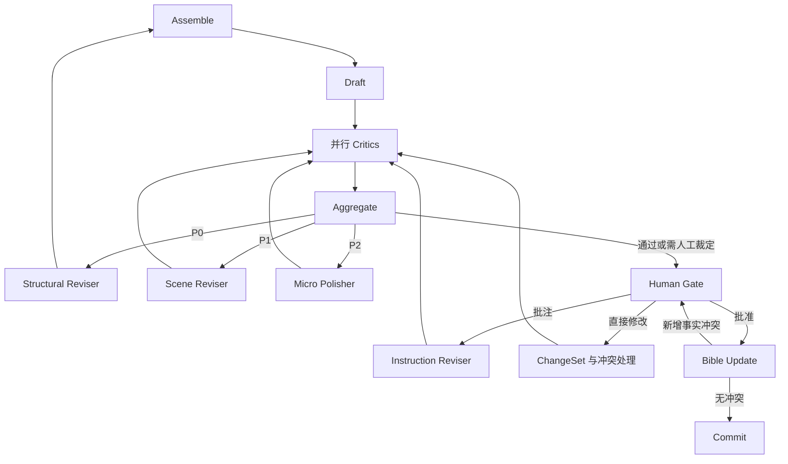

# 墨枢 Inkloom 技术架构与 Agent 开发设计

依据：[原始技术架构与详细设计](/Users/chen.xiao/Downloads/01-技术架构与详细设计.md)。保留原稿的编排、领域模型和 M1～M5 分期，将实现语言及对应工具调整为 Go。本文说明各模块如何工作、如何实现、如何验证；代码级接口随所属阶段细化。

## 1 架构与 Go 选型

系统仍是一条可评测、可中断、可返工、可人工接管的长文本创作流水线。

```text
人机协作界面：审批、批注、直改、影响预览、冲突裁决、分支试写
                         ↓
编排：Plan → Assemble → Draft → Critics → Aggregate → Revise/Polish
                              ↑__________________________|
                         → HumanGate → BibleUpdate → Commit
                         ↓
角色与工具：规划、作者、审查、修订；查卡、检索、统计、事实提案
                         ↓
状态与记忆：Manuscript / Story Bible / Story Graph / StyleProfile
            分层摘要 / 向量记忆 / ChangeSet / 版本
                         ↓
存储与追踪：PostgreSQL + pgvector；Langfuse
```

| 原稿技术职责 | Go 实现选型 | 使用方式 |
| --- | --- | --- |
| LangGraph 状态图与人审 | Eino Graph、State、Interrupt、Checkpoint | 显式节点、条件边、并行评审、暂停恢复 |
| LiteLLM 多模型接入 | Eino ChatModel 适配器 + 按节点配置模型 | 先接一个供应商，M4 再增加模型路由；需要代理时可接独立网关 |
| Pydantic 类型与校验 | Go struct、JSON Schema、业务校验 | 分别校验结构、字段、引用和允许的修改范围 |
| 正式数据与关系图 | PostgreSQL | 保存正文版本、Bible、大纲、关系边、运行状态和 ChangeSet |
| 语义检索 | pgvector | M2 增加 Segment 向量、混合召回与重排 |
| Trace 与评测 | Go OpenTelemetry → Langfuse；Go 评测程序 | 记录节点调用、token、返工、评分与人工决定 |
| 交互入口 | Go HTTP 服务 + 简单网页 | 项目、创作工作台、审批、修改与冲突处理 |

Eino 提供 ChatModel、Tool、Retriever 等组件及图编排；这里使用其 Graph 表达原稿的流程，不改成自由群聊或默认 Supervisor 调度。[Eino 官方概览](https://www.cloudwego.io/docs/eino/overview/)

Graph 的中断和 Checkpoint 可用于保存并恢复运行；持久化存储、业务版本核对及节点副作用仍需应用实现。M1 用小型实际流程验证并锁定框架版本，不假定框架自动解决全部恢复问题。[Eino Interrupt 与 Checkpoint](https://www.cloudwego.io/docs/eino/core_modules/chain_and_graph_orchestration/checkpoint_interrupt/)

## 2 Agent 职责和节点契约

Agent 负责生成、判断和必要的工具选择；编排器负责顺序、状态写入、路由和终止。模型判断可以影响路由，但不能自行绕过人审或增加无限调用。

| 节点 | 输入 | 输出 | 是否允许自主判断 |
| --- | --- | --- | --- |
| logline / planner | 创作意图、类型、已锁定内容 | 立意、人物卡、世界规则、层级大纲、Beat 候选 | 提出创作方案，由作者锁定 |
| context_assembler | 本章 Beat、人物、时间位置、上下文预算 | ContextBundle 及来源清单 | 在必需材料之外决定补查什么 |
| draft_writer | ContextBundle、StyleProfile、VoiceProfile | 与 Beat 对齐的 Segment 草稿 | 在约束内创作，不改锁定设定 |
| hard_consistency_critic | 正文、Bible、时间线、InfoState、伏笔 | 一致性 Findings | 判断冲突，可调用查证工具 |
| style_critic | 正文、统计结果、StyleProfile | 风格偏离 Findings 与距离 | 统计计算加语义判断 |
| ai_taste_critic | 正文、词表、句法和重复信号 | 套话、空泛、telling、对白等 Findings | 对具体表达给证据和建议 |
| reader_critic | 当前正文、阅读目标 | 悬念、动机、节奏和阅读意愿评审 | 独立读者视角判断 |
| aggregator | 同一稿本的各类 Findings | 去重问题、优先级、修复范围、下一节点 | 路由由规则决定，争议交人审 |
| structural_reviser | P0、相关 Beat/大纲、约束 | 结构修订候选 | 在授权范围内提出修订 |
| scene_reviser | P1、相关场景、约束 | 场景或段落修订候选 | 不擅自改其他章节 |
| micro_polisher | P2、命中句、风格与人物声音 | 局部修订及 diff | 以保语义为目标，仍须复检 |
| instruction_reviser | 人工批注、原稿、允许范围 | 指令式修改候选与 diff | 服从本次人工指令 |
| bible_updater | 已审核正文、已有 Bible | 事实、人物状态、时间线、伏笔变化提案 | 提取与对齐，不自行裁定冲突 |
| human_gate / commit | 候选版本、报告、审批决定 | 等待/恢复，或正式版本 | 程序执行，不是模型节点 |

每个角色使用独立消息上下文。Critic 看正文和必要证据，不看作者节点的自我辩护。节点共用模型适配层，可以使用同一模型；不同职责不需要拆成不同服务。

### Prompt 与结构化输出

Prompt 分为职责与边界、输出 Schema、任务要求、故事材料四部分。模板及版本独立保存；正文中的指令式句子按故事材料处理。Writer 输出中带 Beat 与 Segment 关联；Critic 必须返回问题类型、严重级别、位置、证据及修复建议。

```json
{
  "draft_version": 3,
  "findings": [{
    "id": "f1",
    "critic": "hard_consistency",
    "severity": "P0",
    "segment_id": "s18",
    "quote": "他认出了那个从未见过的人。",
    "evidence_refs": ["fact-7@v2"],
    "reason": "已锁定设定中，他既未见过对方，也没有其他识别依据。",
    "suggestion": "补足识别依据，或调整本场景的信息披露。",
    "repair_scope": "beat"
  }]
}
```

Go 解码后继续检查版本、枚举、引用、原文位置和修改范围。有效 JSON 不等于有效证据。无法解析时最多进行一次结构修复；仍失败则记录节点失败，不能当作审稿通过。模型拒绝、输出截断和空响应也要单独处理。

## 3 状态图 编排与自动返工

### 状态如何分层

保留原稿的两层状态，同时增加运行标识便于恢复：

| 状态 | 保存内容 |
| --- | --- |
| GlobalState | project_id、Bible/Outline/Style 版本引用、章节索引、pending_changes、commit_head |
| ChapterState | chapter_id、Beat、draft_version、Segment、Findings、revise_round、gate |
| RunState | run_id、当前节点、节点输入版本、Checkpoint ID、模型与 Prompt 配置、调用用量 |

框架状态传递本次运行需要的数据和引用；正文、事实、评审和历史版本存 PostgreSQL。不能每次从数据库分别取“最新值”拼成一个混合上下文。



图示为完整目标。M1 激活一致性和 AI 味两个 Critic，其他角色按后续模块加入；汇总接口从开始就支持多个评审结果。

### 并行与聚合

Critics 并行读取同一 `draft_version`，各自返回结果，不直接并发修改共享正文。编排器收齐本轮启用的必要评审后，再合并状态。某个必要 Critic 失败时，本轮不能以其他 Critic 的通过代替它。

Aggregator 先校验证据，再按类型、Segment 和重叠位置去重，保留不同理由。优先处理 P0，再 P1、P2；P3 只记录。默认路由沿用原稿：P0 回 Beat/结构，P1 改场景，P2 微改。问题严重程度用于优先级，具体范围还须看证据；无须结构调整的局部问题不扩大重写。

每次修改生成新稿本，复检解决了哪些问题、是否引入新问题。默认最多自动返工 2 轮，可配置为 3 轮；仍不通过则 `escalate`，携带历轮 diff 和未解决问题进入人审。预算、工具次数和调用总次数也设上限，防止返工之外的循环失控。

### 中断与恢复

Human Gate 持久化运行状态并释放执行资源。审批请求携带 `run_id + draft_version`；版本改变后旧审批失效。`approve` 继续事实回写，`redirect/instruct` 进入指定修订，`inline_edit` 进入 ChangeSet 流程。

节点完成产物要保存，恢复时复用已保存的结果。框架中断可能重跑未完成节点，因此正式写入按运行、节点、轮次和输入版本去重。外部模型请求已发送但结果未知时，不能承诺不会重复计费；界面说明后由作者选择重试。

## 4 正文 事实与关系模型

保留 `Project → Chapter → Scene → Beat → Segment`，稳定 ID 负责定位，version 负责追踪修改。

| 对象 | 保留的关键字段与用途 |
| --- | --- |
| Segment | id、chapter/scene/beat_id、order、text、POV、出场人物、实体提及、伏笔引用、style_stats、version |
| Character | name/aliases、want/need/flaw、arc_stage、hard_traits、voice、knows、status_at_chapter |
| WorldRule | scope、rule、hard/soft |
| TimelineEvent | story_time、chapter_id、summary、causal_before |
| Foreshadow | 埋设位置、承诺内容、计划回收章、open/closed/abandoned、重要级别 |
| InfoState | fact、角色或读者、获知/披露位置，必要时关联故事事件 |
| StyleProfile | 类型基调、POV/时态、统计目标、锚文本、禁用表达、VoiceProfile |
| ChangeSet | origin、目标、old/new、reason、blast_radius、conflicts、parent_commit |
| Commit / Branch | 已确认各对象版本、父版本、分支 head，用于比较、恢复与试写 |

Story Graph 用 PostgreSQL 节点和边表，保留 `mentions`、`depends`、`plants/resolves`、`appears_in`、`causally_before`、`knows`。关系记录来源 Segment 及其版本，以便发现正文变化后哪些边需要重新抽取。

正文和已确认 Bible 是不同职责的正式数据；摘要、自动抽取关系和向量是带来源的派生数据。生成标签先作为候选，不因模型返回就自动成为事实。Commit 冻结相互匹配的正文、设定和大纲版本。

M1 只建单章所需的正文、基础设定、评审、运行、版本及简单 ChangeSet；M2 扩展完整记忆实体，M3 扩展影响与分支。保留模型边界，不提前建设所有字段的管理界面。

## 5 上下文工程 分层记忆与 RAG

### 写入与读取

| 层 | 内容 | 写入时机与召回方式 |
| --- | --- | --- |
| 工作记忆 | 当前 Beat、上一段结尾、活跃人物 | 每次写作装配，直接提供 |
| Story Bible | 人物、规则、时间线、伏笔、信息差 | 已确认变化回写，按实体与时间查询 |
| Story Graph | 提及、依赖、因果、获知关系 | 抽取并核对，沿关联扩展证据 |
| 分层摘要 | 章摘要、卷摘要 | 定稿后生成，正文修改后更新受影响摘要 |
| 向量记忆 | 历史 Segment 的 embedding | 按正式文本版本生成，语义召回 |

系统检索自己的创作产物，但只将已确认事实作为可靠设定。摘要中的推断不能自动写回 Bible，避免错误在多轮摘要中被不断放大。

### 上下文装配

1. 读取本次固定的项目与章节版本。
2. 必选本章 Beat、活跃人物与硬规则，加入时间位置、待回收伏笔和上一章结尾。
3. 按实体关系、关键词及向量召回相关前情，合并去重后 rerank。
4. 检查项目、分支、文本版本、叙述位置和角色信息可见性，再组装上下文；受限材料不能先交给模型重排。
5. 预留输出 token，按原稿优先级裁剪低优先级材料；必需约束放不下时停止并提示拆分任务。
6. 保存 ContextManifest：用了哪些材料、来源版本、检索方法、token 估计以及未纳入的材料。

混合检索合并关键词的准确匹配与向量的语义近似，rerank 再按当前场景重排。pgvector 提供向量相似检索；关键词处理、结果融合与 rerank 由应用组合，不能把安装扩展等同于完成 RAG。[pgvector 官方说明](https://github.com/pgvector/pgvector)

保留章节及 POV 过滤。涉及倒叙、插叙时，补充故事事件和获知时点；作者用于埋伏笔的未来规划与角色当前可知内容分区传入，避免将“作者知道”当作“角色知道”。

### Agentic Retrieval 与工具调用

先由程序装配必需材料，context_assembler 可针对缺口进一步查找。工具包括 `get_character`、`query_timeline`、`get_open_foreshadows`、`search_segments`、`get_fact_evidence`；一致性 Critic 可复用这些只读工具查证。

一次工具循环：模型提出工具名称和结构化参数 → Go 校验白名单、参数、项目与版本 → 执行查询 → 将带来源的结果返回模型 → 模型继续判断或结束。初始每节点最多 3 次工具调用，结果大小有上限；重复无增益查询停止。

写入类工具只产生事实或修改提案，由对应应用节点校验后提交。模型不能直接执行任意 SQL。ReAct 用于这些有边界的查询判断，不接管全章的确定性流程。

## 6 多维审查 风格与定向修订

四种 Critic 保留独立职责：一致性查事实，风格检查是否偏离项目画像，AI 味检查具体表达问题，读者检查阅读体验。多个视角用于发现不同问题，不代表投票就是真相。

| 能力 | 实现方式 | 输出与使用 |
| --- | --- | --- |
| 风格指纹 | 句长/段长分布、对白占比、标点、固定窗口词汇统计 | StyleStats 与目标偏差 |
| 语义风格 | LLM 按量表评估叙事距离、潜台词、感官与节奏 | 带原文证据的 Findings |
| AI 味多信号 | 词表命中、重复句式、空泛表达、telling、信息倾倒、对白同质化 | 分项信号、热区、AI-Taste Score |
| 人物声音 | 给每名人物绑定措辞、句式、口头习惯、表达边界 | VoiceProfile 约束及跨章检查 |
| 定向修订 | 指定 Finding、目标 Segment、允许范围、必须保持的事实 | patch/diff 与复检结果 |
| 全稿统稿 | 按章节与场景比较风格、人物声音及阅读节奏 | 分批修订，不把全书强行抹成同一句长 |

保留 AI-Taste Score、Style Distance 及可配置门禁。分值计算需记录特征、权重、归一化和版本，并通过本项目标注样本校准阈值；M1 先输出可解释分项与暂定阈值，不将未校准总分作为唯一拒绝理由。它们衡量项目约定的表达偏差，不代表 AI 来源概率或通用文学质量。

无可靠计算方法的特征标为未启用，不伪造潜台词密度、困惑度或人物声音相似度。禁用词、固定句式可做确定性检查；语义判断由模型给证据、人审处理争议。

Micro-edit 只改命中位置。原稿 §7.5 已要求“分数下降且事实未变”，因此微改后同时复跑风格/AI 味检查和受影响的一致性检查，不能仅回 style_critic 就放行。

## 7 Human Gate 与变更传播

人工介入保持三种路径：锁定创作方向；节点审批与 redirect；成稿后改正文、改设定或下批注。

| 路径 | 处理链路 | 人的决定 |
| --- | --- | --- |
| 自上而下 | 改 Bible/大纲 → ChangeSet → 沿依赖找受影响对象 → stale/needs_review → 修订与复检 | 先看影响，再决定修复范围 |
| 自下而上 | 改正文 → diff → 抽取事实差异 → 与 Bible 对齐 → 更新或冲突 | 人工正文作为意图来源；牵连设定与其他章节时确认 |
| 指令式 | 批注 → instruction_reviser → patch/diff → 人审 → ChangeSet | 采用、调整或放弃 |

影响分析从变动字段出发，沿强依赖传播；弱提及进入复核。遍历用已访问集合防循环，保存影响原因。模型抽取的关系可能遗漏，覆盖不全时扩大复检范围并提示，不能将空结果断言为没有影响。

Conflict 保存 Bible 说法、正文说法、旁证和可选处理：改正文、改 Bible、统一设定。台词谎言或角色误解需区别于世界事实。裁决形成新的变更，随后更新受影响摘要、关系与 embedding；处理结果保留理由，不靠清空问题列表表示完成。

原稿的 `HumanGate → BibleUpdate → Commit` 顺序保留。BibleUpdate 先形成候选变化；无冲突则与正文一并提交，新增冲突回到 Human Gate。不能在 Commit 前将尚未确认的事实暴露给下一章。索引和摘要更新携带来源版本，旧任务不能覆盖新稿索引。

所有内容变动记录 ChangeSet、版本与原因；框架运行状态可正常更新，不把“禁止裸覆盖正文”误解为数据库完全不能执行 UPDATE。M3 加入分支试写与历史恢复：分支使用独立版本和检索范围，采纳试写先比较差异，冲突由作者裁决。

## 8 评测 追踪与成本

### LLM-as-Judge 与回归

量表分别定义一致性、风格、阅读体验，不只写“请打分”。每项要求分数、原文证据和理由；例如动机可信度的低分对应“行为缺少依据”，而非泛泛的“不够生动”。规则可判断的问题优先用规则，模型判断用于语义部分。

固定故事种子，按原稿比较单 Agent、多 Agent 无记忆、完整系统；再单独关闭记忆或返工模块做消融。保持相同题材、目标篇幅和模型配置，报告实际 token 与成本。生成有随机性，多次运行、匿名对比、交换展示顺序，并保留失败案例。无法证明增益时如实记录。

回归集至少包含：硬设定矛盾、时间线冲突、角色提前获知、伏笔遗漏、套话、正常无错文本、角色故意撒谎，以及修改后新增的错误。改 Prompt、模型、检索或门禁时重跑对应集合；真实模型评测由用户显式启动。

### Trace 与调用控制

一次章节运行是一条 trace，每次模型、工具、检索、评审、修订和人工决定是子 span。记录角色、Prompt/模型版本、输入产物引用、输出版本、耗时、token、路由理由及修复的 Finding；不要求保存模型隐藏思维链。

Go 用 OpenTelemetry 导出到 Langfuse，并映射模型、用量和评分属性；M1 保存基础调用记录，M4 补齐分析面板和实验关联。[Langfuse OpenTelemetry 接入](https://langfuse.com/integrations/native/opentelemetry)

每个 Run 配置总调用次数与 token/金额上限；模型调用前检查剩余额度，工具循环、结构修复和重试也计入。Critics 使用受限并发，同一章写作按依赖顺序执行。M4 再比较强模型负责规划/关键节点、较低成本模型负责初稿的效果，不预设便宜模型一定更省总费用。

## 9 分模块建设与学习顺序

沿用原稿 M1～M5，不另设一整期通用基础设施建设。

| 阶段 | 实现范围 | Agent 技术学习重点 | 演示验收 |
| --- | --- | --- | --- |
| M1 单章闭环 | Beat、基础设定与 StyleProfile → 初稿 → 一致性和 AI 味 Critic → 聚合分级 → 自动返工 → 人审 → 定稿 | 结构化输出、Graph/State、并行聚合、条件边、有限循环、Checkpoint/HITL | 一章自动流转；超 2 轮进人审；重启可恢复等待审核；能看 diff、证据和调用记录 |
| M2 跨章记忆 | 完整 Bible/Graph、摘要、pgvector 混合检索、rerank、可见性 | 工具调用、上下文预算、分层记忆、Agentic RAG、信息抽取 | 连续 5～10 章样例；前情可追溯，知识与伏笔用例通过 |
| M3 人机共创 | 三类修改、影响分析、冲突、增量复检、版本与分支 | 状态同步、依赖传播、HITL、带来源的记忆更新 | 改一个旧设定，展示影响、裁决和修复；分支试写互不污染 |
| M4 评测与成本 | Judge、门禁校准、回归、消融、多模型配置、Langfuse 面板 | Agent Eval、可观测、成本与效果比较 | 得到有样例和成本数据支持的模块对比报告 |
| M5 打磨 | 完善 style/reader Critic、人物声音、统稿与去 AI 味 | 多视角评审、风格控制、全稿一致性 | 完整稿件与可回放的创作修订链路 |

Style/reader Critic 的完整模块在后期加入；它们的接口与路由属于整体架构，不能因首期未启用就从设计中删除。规划节点同样保留：M1 可人工录入或导入已确认大纲和 Beat，自动辅助规划随创作入口逐步补齐。

### M1 的实际开发步骤

1. 定义 Segment、Finding、ChapterState 和角色输出 Schema，准备一个短章节的 Beat 与人物设定。
2. 接一个 ChatModel，完成 Writer 和结构化解析；用固定响应测试失败、截断和非法引用。
3. 实现一致性与 AI 味 Critic，对同一稿本并行评审，聚合后得到 P0～P3 和路由。
4. 加入对应修订节点、重新评审与轮次上限；用预设问题验证不同回退路径。
5. 接 PostgreSQL 版本与 Checkpoint，完成 Human Gate 的批准、批注、直改、暂停恢复。
6. 用创作工作台串起流程，展示报告、diff 和调用用量，完成单章定稿演示。

每一步同时讲清输入、输出、状态变化、模型调用和测试依据；先把当前模块做成，再细化下一模块。

### 代码模块

沿用原稿职责组织：`orchestrator/`（图与状态）、`agents/`（角色与解析）、`tools/`（工具及权限）、`memory/`（Bible/Graph/摘要/检索）、`style/`（画像与信号）、`changes/`（变更/影响/冲突）、`eval/`（量表与回归）、`store/`（版本与持久化）。按阶段创建实际需要的模块。

## 10 对原稿的必要澄清

这些是实现边界修正，不改变原编排方案：

- §4.2 的微改回边只经过风格审查，与 §7.5 的事实复检要求不完整一致；实现按 §7.5 补齐相关一致性复检。
- BibleUpdate 在 Commit 前计算候选变化，冲突仍需人审，避免下一章读取未确认事实。
- 风格与 AI 味的计算、门禁能力保留，但统计特征须校准，不能直接当作来源鉴定或文学质量真值。
- `chapter ≤ N` 适用于阅读顺序过滤；倒叙与人物知识还需要故事时间/获知时点。影响图的未覆盖区域需扩大复检，不能保证模型抽取永不遗漏。

原稿中其他章节与模块按其职责落实，不增加语言迁移、微服务、通用调度平台或大规模运维设计。
