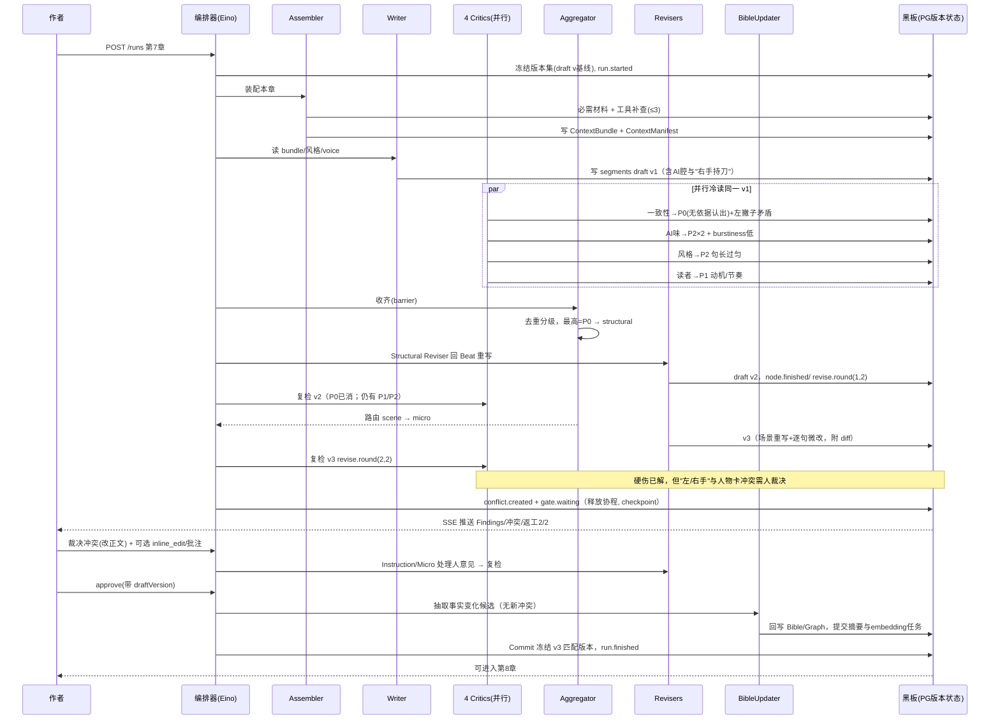

# 墨枢 Inkloom · 各 Agent 职责与交互设计

> 配套：`agent-development.md` §2 节点契约、§3 状态图；本文专门讲清「有哪些角色、各自负责什么、它们之间怎么交互」。

---

## 0. 最重要的一条：Agent 之间不直接对话

本系统**不是**群聊式 multi-agent（A 对 B 说话、B 自由决定叫谁）。交互模型是 **黑板模式（Blackboard）+ 编排器路由 + 隔离上下文**：

```
Agent A 不发消息给 B；
A 只把「结构化产物 X 的某个版本」写进共享状态（Postgres + ChapterState）；
编排器按状态图决定下一步，把 X 的固定版本装进 B 的全新上下文；
B 读完只产出自己的结构化结果，再写回黑板。
```

这么设计的四个理由（也是面试主张）：

1. **可追溯**：任意产物都能回答"谁、基于哪个输入版本、在哪一轮产出的"。
2. **防污染**：每个角色是独立消息上下文；Critic 看不到 Writer 的自我辩护，Reader Critic 才能真正"冷读"。
3. **防失控**：Agent 不能自己叫下一个 Agent、不能无限互调；路由权在确定性图与预算护栏手里。
4. **可测试**：给定输入版本，每个节点可单独用 Fake 模型驱动断言。

所有 Agent 输出都是**带 schema 的提案（proposal）**，不是终稿；经应用层校验、必要时人审，由 `commit` 冻结。**模型提议，程序/人提交。**

---

## 1. 角色全景与自主度分级

| 角色 | 类型 | 自主度 | 一句话职责 |
| --- | --- | --- | --- |
| Planner（立意/大纲） | 生成 | 中（人锁定） | 出立意、人物、规则、层级大纲、Beat 候选 |
| Context Assembler | 程序+Agent | 低-中 | 确定性装配必需材料，缺口处可自主补查 |
| Draft Writer | 生成 | 中（强约束内） | 按 Beat 分块写正文，不得改锁定设定 |
| Hard Consistency Critic | 评审 | 高（判断+查证） | 抓事实/时间线/信息差/伏笔硬伤 |
| Style Critic | 评审 | 中 | 算风格距离 + 语义判断 |
| AI-Taste Critic | 评审 | 中 | 抓套话/水句/telling/对白同质 |
| Reader Critic | 评审 | 高（独立主观） | 悬念、动机、节奏、想不想读下一章 |
| Aggregator | **纯程序** | 无 | 校验证据、去重分级、决定路由，争议交人 |
| Structural Reviser | 修订 | 中（授权范围） | P0：回 Beat/大纲级修，可能跨章 |
| Scene Reviser | 修订 | 中 | P1：场景/段落重写，不动别的章 |
| Micro Polisher | 修订 | 低 | P2：只改命中句，保语义，出 diff |
| Instruction Reviser | 修订 | 中 | 按人的批注出 patch+diff |
| Bible Updater | 抽取 | 低 | 从定稿抽事实变化提案，不裁决冲突 |
| Human Gate / Commit | **纯程序** | 无 | 暂停等人、版本校验、冻结提交 |

> 只有标"高/中"的判断点用模型；Aggregator、Gate、Commit、版本与预算控制是确定性代码。

---

## 2. 逐个 Agent 卡片

### 2.1 Planner（立意 / 大纲架构师）
- **负责**：Logline、核心冲突、母题；人物 want/need/flaw/弧光与 voice 候选；世界硬/软规则；三幕大纲 → Chapter → Scene → Beat。
- **读**：创作意图、类型、基调、目标篇幅、已锁定内容。
- **写**：上述全部为**候选**，带 `locked=false`。
- **工具**：无（M1 可直接由人导入已锁定大纲与 Beat）。
- **边界**：作者锁定后变为约束，后续节点不得违背；改锁定项必须走变更影响流程。
- **成功标准**：Beat 覆盖关键转折、可支撑目标字数；人物弧光与冲突自洽。

### 2.2 Context Assembler（上下文装配器）
- **负责**：写作前决定"这一章让模型看到什么"。
- **确定性部分（程序）**：本章 Beat、活跃人物卡与硬规则、时间线当前位置、待回收伏笔、上一章结尾。
- **自主部分（Agent）**：在预算内判断还缺什么，调用只读工具补查（最多 3 次）。
- **读/工具**：`get_character`、`query_timeline`、`get_open_foreshadows`、`search_segments`、`get_fact_evidence`。
- **写**：`ContextBundle` + **`ContextManifest`**（用了哪些材料、来源版本、检索方式、token 估计、未纳入材料）。
- **硬约束**：章节顺序 + 故事时间/获知时点 + POV 三重可见性过滤；作者的未来伏笔规划与角色当前可知内容**分区**传入。

### 2.3 Draft Writer（分章作者）
- **负责**：按 Beat 逐 Segment 产出与节拍对齐的正文；执行 StyleProfile 与本人 voice；给每段打结构标签。
- **读**：ContextBundle、StyleProfile、相关 VoiceProfile、本段量化目标（句长区间/对话占比/感官细节数/禁用词）。
- **写**：`Segment[]`（含 beatId、pov、charactersPresent、entitiesMentioned、foreshadowIds、draft_version）。
- **边界**：在约束内创作，**不得改任何锁定设定**；需要的事实只能查、不能编。
- **多声音**：对白生成绑定说话人 voice，机制上避免全员同嘴。

### 2.4 Hard Consistency Critic（一致性审查官）
- **负责**：抓 P0/P1 硬伤——违反硬规则、时间线错乱、伏笔穿帮、角色提前获知、"认出从未见过的人"这类无依据信息。
- **读**：正文（固定版本）+ Bible + 时间线 + InfoState + 伏笔；可用只读工具**取证**。
- **写**：`Finding{severity, segment_id, quote, evidence_refs, reason, suggestion, repair_scope}`。
- **特殊**：区分"世界事实矛盾"与"台词谎言/角色误解"（后者不是硬伤）。证据不足不下 P0 结论。

### 2.5 Style Critic（文风编辑）
- **负责**：对标 StyleProfile 的偏离。
- **读**：正文 + `StyleStats`（程序算好）+ 目标画像。
- **写**：风格类 Findings + Style Distance；语义维度（叙事距离/潜台词/感官/节奏）给分必须附原文证据。
- **纪律**：未校准特征只提示，不因某个常用词或句长波动判不合格。

### 2.6 AI-Taste Critic（去 AI 味审查）
- **负责**：五类信号——词表（嘴角勾起/一股难以言喻的…）、句法（句长方差过小、"的"字链、对仗排比）、语义（水句、cliché 比喻、把潜台词说破、信息倾倒）、统计（burstiness 偏低）、对白（过书面、跨人物声音同质）。
- **写**：逐句/逐段热区 + 分项信号 + AI-Taste 建议；可计算项由程序特征提供，语义项由模型给证据。

### 2.7 Reader Critic（模拟读者）
- **负责**：独立冷读体验——悬念、人物动机可信度、节奏、代入感、"是否想读下一章"。
- **读**：**只给正文和阅读目标**，不给大纲/作者意图/其他 Critic 结论（保证独立视角）。
- **写**：带 rubric 的评分 + 原文证据（动机低分要对应"行为缺少依据"，不是"不够生动"）。

### 2.8 Aggregator（聚合裁决器，纯程序）
- 校验每条 Finding 的引用与版本 → 按类型/段/重叠区间去重（保留不同理由）→ P0>P1>P2 排序，P3 只记录 → 按规则选路由。
- **不投票**：必要 Critic 失败不能被其他通过替代；有争议/证据不足交人审。
- 输出下一步：structural / scene / micro / human_gate。

### 2.9 三个分级 Reviser + Instruction Reviser
| 节点 | 触发 | 动作 | 硬约束 |
| --- | --- | --- | --- |
| Structural Reviser | P0 | 回到相关 Beat（必要时上游大纲）重写，可能产生跨章影响 | 只在授权范围，跨章走变更预览 |
| Scene Reviser | P1 | 场景/段落级重写 | 不改其他章节 |
| Micro Polisher | P2 | 只动命中句，保语义 | 出逐句 diff，复跑风格+一致性 |
| Instruction Reviser | 人批注 | 按批注（如"让他失态但不改事件结果"）出 patch | 服从本次指令与允许范围 |

每次修订都生成**新 draft_version**，然后回到 Critics **复检**：解决了什么、有没有引入新问题。

### 2.10 Bible Updater（事实回写器）
- 定稿后增量抽取：新事实、人物状态/弧光变化、时间线事件、伏笔开/闭。
- 只产**候选变化**；与 Bible 比对，冲突交 Human Gate，**不自行裁决**；摘要推断不自动回写 Bible。
- 通过后才更新关系边、触发章/卷摘要与 embedding 的异步任务。

### 2.11 Human Gate / Commit（程序节点）
- Gate 调 Eino Interrupt：落 checkpoint、释放执行资源、`gate.waiting`。
- 接收 `approve / redirect / instruct / inline_edit / cancel`，**带 draftVersion**：版本不符 → 409 + `version.stale`，旧审批失效。
- Commit 单事务冻结相互匹配的正文/Bible/大纲版本（commit_refs），run 完成，未确认事实绝不暴露给下一章。

---

## 3. 交互模式（复用的 6 种"套路"）

1. **黑板读写**：所有协作通过版本化产物，零直接对话。
2. **扇出/扇入（fan-out/fan-in）**：4 个 Critic 并行读同一 draft_version → barrier 收齐 → Aggregator。
3. **条件路由**：按最高严重级别走不同 Reviser（P0 回 Beat、P1 改场景、P2 微改、通过进 Gate）。
4. **反思闭环（Reflection）**：Revise → 回到 Critics 复检，最多 2（可配 3）轮，超限 escalate。
5. **工具中介的记忆访问**：Agent 不直接读库，经白名单只读工具拿"带来源的结果"；写操作只产提案。
6. **人在环中断/恢复**：Interrupt 暂停 → 前端 SSE 展示 → 人决策带版本 Resume。

贯穿的护栏：每节点工具 ≤3 次、结果大小上限、总调用/token/金额预算、写入按 `(run,node,round,input_version)` 幂等。

---

## 4. 用「第 7 章 · 夜谈」走一遍真实交互

数据：v3，in_review，自动返工 2/2；1 个 P0（认出从未见过的人）、2 个 P1（动机、节奏）、若干 P2（两处 AI 腔、句长太匀）；1 条冲突（人物卡=左撇子 vs 正文"右手持刀"，旁证第 3 章写左手）。



要点复盘：
- Writer 与所有 Critic **互不见面**，Critic 之间也不见面，只通过 v1/v2/v3 版本产物协作。
- 同一条"右手持刀"，Critic 报为 Finding、Aggregator 升级为 Conflict、最后由人裁决——**模型从不替人拍板事实**。
- 两轮返工是图强制的，不是 Agent 自己决定何时停；到上限仍有未决项就 escalate，而不是无限循环。
- 人在 Gate 的每个动作都带版本，他若在别处改了稿子，旧审批立即失效（409）。

---

## 5. 给前端可观测的映射

- 每个 `node.started/finished`、`revise.round`、`findings.ready`、`conflict.created`、`gate.waiting` 都是 SSE 事件，驱动底部 React Flow 节点高亮、回退边动画、Findings 列表与冲突红点。
- 点任意节点能看到：读了哪个版本的什么材料（ContextManifest）、产出了哪个版本、理由/证据、token 与耗时——把"Agent 之间怎么交互"完全可视化、可回放。
