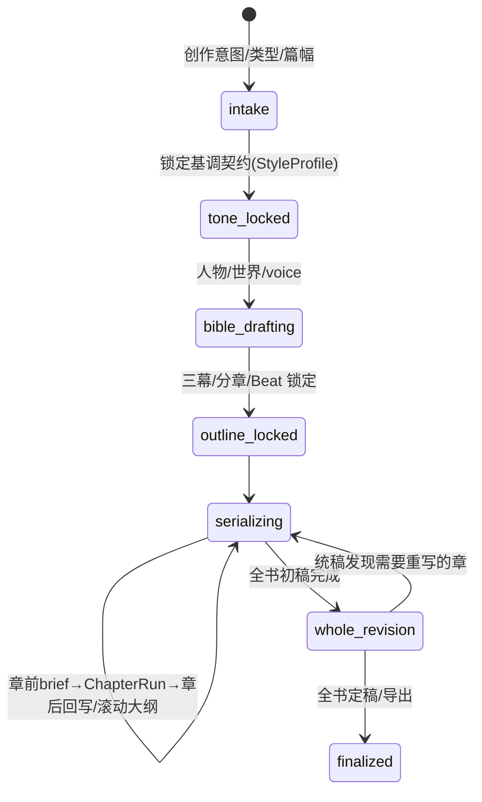
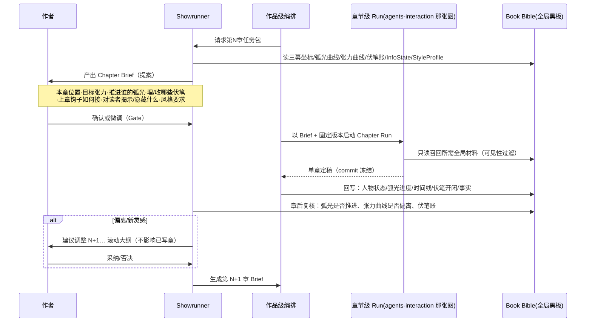
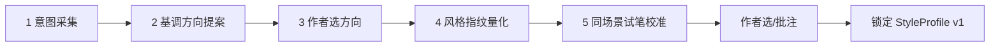

# 墨枢 Inkloom · 作品级编排与基调（Tone/Style）设计

> 单章闭环见 `agents-interaction.md`；本文讲它之上的两层：
> ① **作品级编排**：谁对全书负责、章节之间怎么接力、跨章质量谁来守；
> ② **基调确立**：作品调性如何从作者的模糊意图，变成一份人机共定、可量化、可演化、可守护的契约。

---

## 1. 两层编排：作品级稀疏、强人工；章节级密集、强自动

```
作品级 Book Orchestration（创意决策多，人工 Gate 密，节点稀疏）
  立意 → 定调 → 人物/世界 → 结构大纲 → ┌─ 逐章生产循环 ─┐ → 全书统稿 → 定稿
                                     │ 章前brief      │
                                     │   ↓            │
                                     │ 章节级 Chapter Run（M1 那张图，高度自动）
                                     │   ↓            │
                                     │ 章后复盘/回写  │
                                     └────────────────┘
        黑板 = Book Bible（全局、跨章、版本化）
```

| | 作品级 | 章节级（已有） |
| --- | --- | --- |
| 状态 | BookState、Master Outline、Book Bible、弧光/张力曲线、伏笔总账、**StyleProfile** | ChapterState、segments、findings、draft_version |
| 节奏 | 稀疏，一个阶段一次或每章前后各一次 | 密集，一章内多节点多轮 |
| 自主度 | 低，**创意方向由人锁定**，Agent 提案 | 中，约束内自动创作/评审/返工 |
| 黑板 | Book Bible（跨章） | Chapter 工作区 + 只读召回 Book Bible |
| 失败处理 | 回到作者做创意裁决 | 自动返工 2 轮，超限 escalate |

原则：**章节级追求自动化，作品级追求可控的创作意图**。越往上，人越像"作者/导演"，AI 越像"编剧团队"。

---

## 2. 作品级状态机



- 已写章节与已锁定设定进入冻结区；未来大纲允许 **rolling outline（滚动大纲）**——写到第 7 章可调整 8–12 章计划（便宜），但若改动波及已写章，则走 ChangeSet 影响传播（昂贵，需人确认）。
- 每个阶段转换是一个人工 Gate；`tone_locked` 与 `outline_locked` 是两道最关键的锁。

---

## 3. 作品级角色（在章内角色之外）

| 角色 | 层级 | 职责 | 自主度 |
| --- | --- | --- | --- |
| **Showrunner 总编/统筹** | 作品级 | 守母题与主题线、调度人物弧光与张力曲线、决定每章推进哪条线、复核并调整滚动大纲 | 中（提案，人拍板） |
| **Story Architect 规划师** | 作品级 | Logline、三幕、分章、Beat；维护关键转折与因果 | 中（人锁定） |
| **Tone/Style Director 基调总监** | 作品级 | 产出基调方向、建立并守护 StyleProfile、裁定计划内/外风格漂移 | 中 |
| **Continuity Keeper 全书连续性** | 作品级 | 跨章硬伤、人物缓慢走样、设定累积矛盾、时间线总账（章内 critic 只看本章+召回） | 高（判断+图查证） |
| **Saga Reader 卷/全书读者** | 作品级 | 不只评单章，评跨章悬念、节奏曲线、满足感、伏笔回收体验 | 高（独立冷读） |
| **Final Polisher 统稿编辑** | 作品级 | M5 全书风格平滑、voice 跨章一致、按 styleArc 保留节奏差异 | 中 |

> 章内的 Writer / 4 Critics / Revisers / Bible Updater 不变；作品级角色更多是"周期性"运行（每章前后、卷末、全书），不参与章内高频循环。

---

## 4. 逐章生产循环：作品级 × 章节级怎么交接

每一章不是孤立启动，而是有"章前任务包"和"章后复盘"：



要点：
- **Chapter Brief 是两层之间的契约**：它把"全书意图"翻译成"这一章必须完成的叙事任务"，章节级 Writer 不是自由发挥，而是在 Brief + Beat + StyleProfile 三重约束内创作。
- 每 3–5 章或卷末，Continuity Keeper 做一次**全书 sweep**（抓单章 critic 看不到的累积漂移），Saga Reader 做一次跨章冷读。
- 改已锁定的作品级设定（母题、主角弧光、基调）= 最高影响变更，blast radius 可能覆盖全书，必须人确认。

---

## 5. 重点：作品基调（Tone）是怎么确定的

先区分两个常被混用的概念：

| | 基调 / 调性 Tone & Mood | 文风 / 文笔 Style |
| --- | --- | --- |
| 是什么 | 读者的情绪体验：冷峻、阴郁、荒诞、温柔、压迫感 | 语言肌理：句长、对白比例、用词、标点、节奏 |
| 性质 | 偏主观、语义层 | 可统计、可计算 |
| 谁定 | 作者 + Tone Director 共定，作者拍板 | 由基调翻译而来，系统量化执行 |
| 怎么测 | LLM Judge 按 rubric + 人感 | StyleStats 与目标区间的距离 |

**关系：基调是"想要的体验"，文风是"实现它的语言手段"。StyleProfile 就是把主观基调翻译成可执行、可测量约束的那份契约。**

> 核心主张（可直接用于答辩）：**基调不是写在 prompt 里的一句"请写得冷峻一点"，而是一份人机共定、定性+定量、经过试笔校准、并在全书被持续守护与有计划演化的契约。**

### 5.1 基调确立五步（Tone Onboarding）



1. **意图采集**：类型、母题、目标读者、情绪关键词、POV/时态/篇幅；作者可上传**对标作品片段或自己过去的文字**作为审美锚点（可没有）。
2. **基调方向提案（Tone Director）**：产出 **2–3 个并列的 ToneBrief**（不是一个），每个像 mood board：基调陈述、情绪光谱、叙事距离、节奏倾向、对白气质、**明确的"禁忌味道"**。例：
   - A 冷峻克制（远叙事距离、白描、低形容词、短对白）
   - B 潮湿阴郁（近距离、多感官、长句缠绕、内心独白密）
   - C 黑色荒诞（克制中突梯、对话机锋、节奏跳切）
3. **作者选方向**：创意决策必须由人选；可在某个方向上批注微调。
4. **风格指纹量化**：
   - 有对标范文 → 用确定性特征提取统计指纹（句长分布/burstiness/对话占比/标点指纹/感官与词汇层级/段落节奏）；
   - 无范文 → 由 ToneBrief + 类型推出**目标区间（不是定值）**。
5. **同场景试笔校准（Style Probes，最关键）**：拿**同一段 beat**，按选定方向写 2–3 个风格样本（差异在句长/叙事距离/对白密度），作者选择 + 圈点批注（"这段太满""这句对味"）。系统把选择反推为风格权重与硬约束——**这一步是人在"教"系统自己的审美**，样本同时成为后续 few-shot 锚文本。

### 5.2 锁定的 StyleProfile 包含什么

```text
定性层：toneStatement（基调陈述）、moodSpectrum、narrativeDistance、禁忌味道、对标锚文本
定量层：targetRanges（句长区间/burstiness/对话占比/标点/感官密度）、bannedLexicon、节奏曲线模板
硬约束：person(人称)/POV/tense(时态) —— 全书不可漂移，改则走最高级变更
声音层：各人物 VoiceProfile（在人物阶段从 StyleProfile 派生，再各自试笔校准）
演化层：styleArc（可选）—— 按幕/章计划内的基调演化曲线
元数据：calibrationSamples、version、locked、阈值是否已校准
```

- **硬约束 vs 软目标分开**：人称/POV/时态是硬的；句长区间、用词是软的，允许区间波动。
- 未校准阈值只作提示（沿用质量引擎纪律），不会因句长波动就判不合格。

### 5.3 基调的守护与有计划演化

- **每章守护**：Style Critic 比对 StyleProfile，输出 Style Distance 与具体偏离句；AI-Taste Critic 守"去 AI 味"底线。
- **允许计划内漂移**：用 `styleArc` 表达风格随情节演化（如悬疑前半克制、真相段爆裂）。系统区分：
  - **计划内漂移**（落在 styleArc 预期内）→ 通过；
  - **计划外漂移**（人物声音走样、叙述者距离莫名变化、AI 腔回升）→ Finding。
- **全书统稿（M5）**：Final Polisher 画全书"风格漂移曲线"，对计划外漂移平滑，但**保留动作戏与抒情戏的节奏差异**，不把全书抹成一个句长。
- **改基调是高代价操作**：`tone_locked` 后改 StyleProfile 触发 ChangeSet，blast radius 覆盖全书已写章，须作者确认并重跑统稿——所以前置的试笔校准很重要。

---

## 6. 落到增量迭代（什么时候建什么）

| 时机 | 建什么 | 说明 |
| --- | --- | --- |
| M1 准备期 / I4 前 | StyleProfile 最小版：禁用词表 + 句长/burstiness 目标 + POV/时态硬约束 | 供 AI-Taste/Style Critic 使用；可由作者直接录入或上传 1 篇范文自动统计 |
| M1 准备页 | Tone Onboarding 半自动：意图表单 + 上传范文算指纹 + 锁定 | 方向提案与试笔校准可先人工/简化 |
| M2 末 | Chapter Brief 生成器：从已锁定大纲/Bible 读章任务包 | 先确定性模板生成，Showrunner 建议后置 |
| M3 | Showrunner 章后复盘 + rolling outline 调整 + 改已写章的影响传播 | 与 ChangeSet 引擎汇合 |
| M3–M4 | 全书 sweep（Continuity Keeper）、Saga Reader 跨章冷读 | 周期性运行，不进章内高频循环 |
| M5 | styleArc、风格漂移曲线、Final Polisher 统稿 | 全书质感收口 |

> 即使 M1 没有自动 Showrunner，**StyleProfile、Chapter→Beat 的任务约束、伏笔/弧光字段也要从第一天就存在**（可人工填），保证后期是"接上自动能力"，而不是回头改数据模型。

---

## 7. 一页速记

- 作品级 = 稀疏、强人工的"导演层"；章节级 = 密集、强自动的"编剧执行层"；靠 **Chapter Brief** 和 **章后回写** 交接。
- 跨章质量靠 Showrunner（走向/弧光/张力）、Continuity Keeper（累积漂移 sweep）、Saga Reader（跨章体验），不是靠章内 critic 硬撑。
- 基调 = Tone（体验，人定）翻译成 Style（语言，系统测）；通过 **意图→多方向提案→人选→指纹量化→同场景试笔校准→锁定** 五步确立。
- StyleProfile 分硬约束（人称/POV/时态）与软目标（句长/用词），并支持 styleArc 计划内演化；计划外漂移才报警。
- 改基调/母题/主角弧光是最高影响变更，走全书级 blast radius——所以前期校准值得多花时间。
