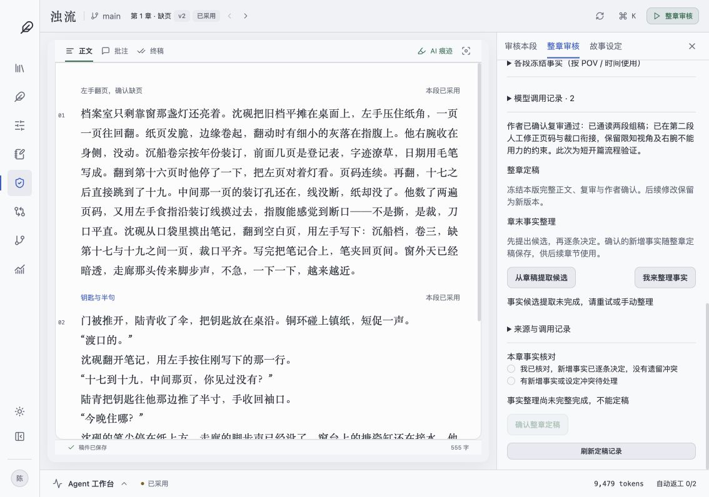

# 《浊流》真实创作流程试跑 · 2026-10-16

## 范围与结果

使用浏览器操作真实 Go / PostgreSQL / DeepSeek 流程，按作者授权代做选择。以第一章 600 字、一个场景两个 Beat 的短开篇验证交互，不代表完成整本小说。界面最终复用原有 TipTap 工作台；独立简易页面已删除。

已完成：准备材料逐步确认 → 发布初始知识 → 两段生成 → 原地编辑第二段 → 双 Critic 复检 → 两段分别批准与采用 → 保存整章 → 整章双 Critic 复审 → 作者确认复审通过。

未完成：自动章末事实提取失败，整章未定稿。手动接管入口已改为站内确认弹窗并通过回归测试，但浏览器控制在旧原生确认框之后出现超时/点击无响应，未完成该路径的真实浏览器验收。没有绕过事实门禁，也没有用 SQL 或假数据补成成功。

## 数据核对

| 对象 | 标识 / 结果 |
| --- | --- |
| 立意选择 | job 35290fba-27bb-4f2b-a984-4b911908a998，选择“浊流·证词之网” |
| 风格试写 | job 452e5a34-25ea-48f9-aac0-e4a2e2345f82，人工修正右腕用力描写，确认 v1 |
| 人物世界 | job 3327a2fe-2219-4d71-a767-fc3542861be3，3 人物、6 事实、2 未来计划 |
| 分章大纲 | job 6d7a5bf0-04c8-4371-8f1c-c117eef2d96c，6 章；首章“缺页”用于短篇幅试跑 |
| 当前章 | ol-7470f97e81626dd3-c1 |
| 初始知识 | v1，digest 63e0c1f4f1a32dbbcb216a232fc1873181c89c274ce4642e59dfafdaeeb939b1 |
| 第一段 | run e5b2c8f7-d73d-4bc0-b613-5d1ce46ba475，committed v1，commit 33efbed8-5e6c-4d46-9162-3176cc052251 |
| 第二段 | run 02db4710-09e4-494e-9a7f-0607e2d9f96d，人工直改后 committed v2，commit 9d831198-569a-4f90-a5dc-797da72f7713 |
| 整章 | b1501d52-1f00-40fd-9771-6041987ff98c，v1，两段，界面统计 555 字 |
| 整章复审 | 4943f4f4-3cc9-4044-afce-107c112a40dd，两路均未报告问题，作者确认通过 |
| 事实提取 | f5a8597d-fab2-4c29-a9f6-3aa07704cc7f，failed；模型调用 finished / success=true / complete，4,441 ms，输入 4,708、输出 841 tokens |

初始 Writer 材料仅纳入沈砚在该时点可用的惯用手与父亲相关事实。未混入演示 ch7 正文；未来计划、其他人物未公开知识没有作为已发生事实注入。

## 发现的问题

1. **章内连续上下文仍缺失。** 第一段明确写裁口平齐，第二段模型却写断口发毛，且把页码称为日期。单 Beat 审查未拦住。已在原编辑器人工修正并复检；后续应把前段已采用正文和状态交给下一段 Writer，不能靠反复改提示词解决。
2. **准备材料仍需作者核验。** 风格锚文本曾出现受伤右腕用力，模型给出的“次日”时间也需人工校正。本次选择前已修正；不能只看候选格式合法就自动锁定。
3. **细纲时间粒度。** 当前时间标注在 Scene，单场内两 Beat 的细微时间推进不能单独表达；后续应明确时点/时段语义。
4. **事实提取失败缺诊断。** 模型调用记录显示正常完成，但任务 failed，只保留通用错误文案。当前证据不足以确认是解析、校验还是其他后处理原因；应保存分类错误和安全的具体原因。
5. **模型空意见不等于查证完备。** 本次整章两路空意见仍经过作者通读确认，没有当作自动定稿依据。
6. **浏览器接管验证未完成。** 旧原生确认框后的工具超时阻止了最后手动事实路径的实测。已替换为 Radix 站内弹窗；对应“失败后重开手动整理 → 保存逐条决定”的回归通过，仍需补真实浏览器复验。

## 本轮修正的前端问题

- 删除 PlannedWorkspace、PlannedBeatWriting、live-writing-layout 及独立样式，复用原编辑器、工具条、gutter、主题与工作台布局。
- 审核和整章核对保留在正文旁；历史复审显示精确冻结稿本。
- 修复窄窗口审核侧栏覆盖正文，改为同屏分栏。
- 正文/指令绑定 run 与稿本版本，暂存、切换保护、旧版本禁用；未知请求和中断动作保留原操作 ID 重试。
- 请求确认后到复检完成之间，显示待处理的作者文本，避免闪回旧正文。
- 当前 Beat 写入 URL，刷新后保留写作位置；Mock 正文与真实规划明确隔离。

截图：

