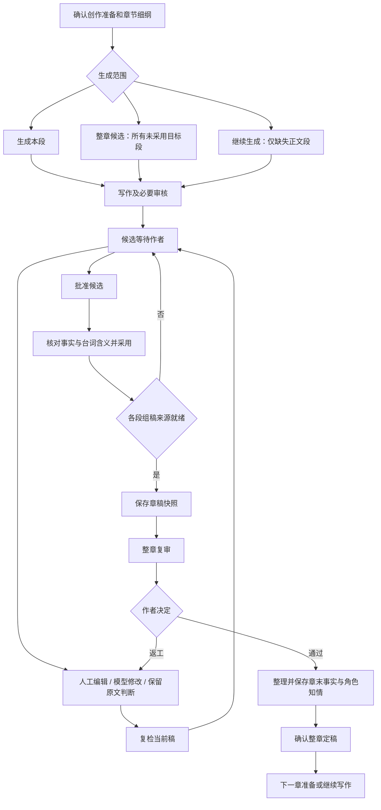

# 正文交互专项优化方案

日期：2026-10-18。状态：已完成代码与真实页面审计，待实施。

本方案承接现有真实创作流程，不另做演示版。此次只新增方案文档，没有修改产品代码、调用生成、提交作者决定或改变作品正文。页面状态会随作者操作变化，下述运行观察是本次读取时的快照。

## 1. 审计结论与范围

本次检查了 WritingManuscript、SegmentEditor、writing-workspace、finding-actions、useWritingActions、usePlannedWriting，以及 ChapterAssembly / ChapterReview / ChapterFacts / ChapterPublication 和后端 HumanAction 校验。

真实页面：第三章显示“1/4 段已有采用稿，其中 1 段有新修改待采用”；第一段展示新候选，保留已采用 v4，当前保存对照为 v5 → v6。其余三段显示待审核候选。本次没有替作者确认任何内容。

主要问题：

1. 采用、选中、编辑、审核和运行状态相互混用。正文 section 目前只有 is-active 样式，采用状态主要藏在段首标签，滚动后失去上下文。
2. 已采用版本和正在显示的新候选可同时存在。一个 accepted 布尔值不能完整表达这层关系；“已有采用稿”与“当前稿已采用”必须区分。
3. 相同意图有不同条件。直接编辑依赖 waiting_human；已采用稿的 P2/P3 模型修改已支持新候选预览，但直接编辑入口仍可能要求先重新生成。
4. 同样叫“让模型修改”，P2/P3 走局部预览，P0/P1 和作者要求核对问题仍走通用重写及复检。不能通过调整文案宣称两者已统一。
5. 普通人工正文修改保存后自动复检；P2/P3 问题内人工修改和选区预览应用后可统一复审。用户很难预测一次保存会触发什么。
6. 已接入 diff，但正文卡、审核回执、修改历史可能重复展示，长卡片和多层滚动打断阅读。
7. “终稿”当前是现有正文的只读净读模式，不负责加载定稿快照；“批注”切换会打开审核面板，正式作者批注协议尚未接入。名称与实际能力不一致。
8. 全局 busy/dirty 经常连同阅读定位一起限制。错误、运行中、上下文变化、待确认预览不是同一类状态，却仍有入口用泛化提示。
9. 已有的正文底部保存条、邻段变化保留采用、事实批量决定、审核与作者决定分栏应继续复用，不推倒重做。

覆盖：准备和加载、生成、阅读定位、选区、人工编辑、模型修改、问题裁定、复检、批准/采用、组稿/复审、事实/知情、定稿/续章，以及失败、版本变化、刷新和窄屏。正式批注、跨段原子修改、任意运行暂停、定稿后独立修改知情等尚无完整协议的能力单独列出，不能展示假入口。

## 2. 当前真实流程及全部主要操作分支

### 2.1 主链路



这不是自动批准链。保存、批准、采用、定稿各自有不同含义；整章审核不是逐段审核的同一个任务。

### 2.2 分支清单：当前行为与优化要求

| 编号 | 场景 / 触发 | 当前行为 | 目标交互 |
| --- | --- | --- | --- |
| A01 | 准备或细纲未就绪 | 生成被前置条件阻挡 | 空白区列具体缺项和直达入口，不展示空泛失败 |
| A02 | 正文加载中 / 某段读取失败 | 有加载和逐段重试；失败不等于无稿 | 保留其他段，失败段局部重试，禁止误当空白重新生成 |
| A03 | 全章无正文 | 可生成本段或整章 | 主按钮生成整章候选，范围菜单保留单段；提交前显示目标段和目标篇幅 |
| A04 | 只有部分段有正文 | 支持整章候选、继续生成剩余 | 主按钮“继续生成剩余 N 段”；说明哪些保留，哪些有候选但仍属于整章生成目标 |
| A05 | 所有段已有正文但未全采用 | 继续生成禁用；整章仍可生成未采用目标 | 主动作变为处理待审稿；整章再生成放次级入口，明确原候选保留 |
| A06 | 全部采用 / 已定稿 | 已采用正文排除生成目标 | 引导整章检查或下一章，不诱导无目标的重复生成 |
| A07 | 生成中 / 部分产物已保存 / 失败 | 有持久化产物和恢复流程 | 显示实际阶段及已完成目标，恢复原请求；禁止伪百分比和自动覆盖旧采用稿 |
| B01 | 读正文、切段、点问题 | 部分切换受 dirty/busy 限制；问题定位会滚动 | 阅读浏览与写入目标分离；只在主动定位时滚动，运行不锁阅读 |
| B02 | 正文 / 批注 / 终稿切换 | 批注打开审核；终稿是净读模式 | 改为“正文 / 审查标记 / 净读”；另设明确的已采用稿、定稿和历史版本入口 |
| B03 | 无选区 / 有选区 / 跨自然段选区 | 选区绑定单个 segment；无选区可重写本段 | 显示范围与字数；范围缺失不能自动退化为重写全文 |
| B04 | 跨 Beat / 多编辑器选区 | 单目标协议不能表达多个目标 | 明示需分段处理，保留用户意图；禁止悄悄只提交第一段 |
| B05 | 查设定、前情或人物知情 | 只读查询；不授予角色知识 | 小面板保留选区；关闭回到原处，不改变当前写入目标 |
| C01 | 待审稿直接修改未被标记的文字 | 当前可直接编辑，保存并复检 | 原地编辑；底栏“保存修改”，可选择保存后复检；默认连续修改后统一检查 |
| C02 | 点击问题的“我来修改” | P2/P3 有引用范围编辑，其他路径不同 | 与正文编辑共用编辑器、保存和撤销；卡片只提供定位、建议与范围 |
| C03 | 已采用 / 已批准稿直接编辑 | 直接编辑受 waiting_human 限制 | 首次实际写入建立新候选，原采用版本保留；点击编辑本身不调用 Writer |
| C04 | 人工修改未保存 | sessionStorage 暂存，保存条；部分其他动作受阻 | 底栏常驻显示作用段；明确只在本机，保存、撤销就近完成 |
| C05 | 放弃本地修改 | 已有直接清空逻辑 | 立即还原本次本地编辑，不弹确认；同会话提供“恢复刚才修改”，需要实现可恢复缓冲 |
| C06 | 无实际改动 / 中文输入合成 | 后端拒绝无变化；dirty 由草稿记录驱动 | 与基准比较，改回原文清 dirty；输入法组合期间不提交或抢焦点 |
| C07 | 已存本地修改遇到远端新版 | 版本不一致阻止保存 | 展示本地/服务器差异，复制本地或重新定位；不能通过“先复检”丢掉草稿 |
| D01 | 自选句子让模型修改 | 选区走 propose_selection 或新候选预览 | 同一句旁填写要求 → 生成预览 → diff → 应用到候选 / 放弃 |
| D02 | P2/P3 问题让模型修改 | 等待态局部预览；已采用稿新候选预览 | 与 D01 同一套交互；问题证据自动带入，可编辑修改要求 |
| D03 | P0/P1 或作者要求核对未通过 | 当前通用重写并复检，无统一预览 | 也先展示 diff；应用后强制完成必要复检，严重程度决定门禁而非是否能看预览。需后端扩展 |
| D04 | 未选文字，要求重写本段 | 通用重写路径 | 明确标题“重写整个情节段”；单独范围入口，返回仍需 diff，旧采用稿保留 |
| D05 | 跨段冲突 | 读取相关上下文，单次只写目标 | “修改第 4 段；参考第 1、3 段”可展开证据和版本；两段都要改时列独立待办，不伪装原子批量 |
| D06 | 无引用 / 重复引文 / 原文已变 | 定位或版本校验失败 | 留在原卡，给“重新选择范围”；不自动扩大范围，不默默取首个同名句 |
| D07 | 模型预览生成中 | 局部锁定相关写入 | 就近显示生成阶段，正文保留；允许阅读别段和查设定 |
| D08 | 预览就绪 / 应用 / 放弃 | 已有 diff；应用后 reviewPending | 明确“应用到候选”而非“采用本段”；保留其他问题；无变化响应不创建假修改 |
| D09 | 应用后再次修改 / 需要撤销 | 有修改历史与 diff，非完整版本恢复 | 支持查对照；保存后撤销需新增逆向补丁与版本校验，不能假设已支持 |
| E01 | P3 保留原文 / 撤销决定 | 当前版本记录作者判断，不调用模型 | 单击处理，理由可选，提供撤销；版本变化后展示决定来源，不能自动视为新版本已确认 |
| E02 | P0–P2 想保留原文 | 后端批准门禁仍阻止；保留记录不绕过 | 入口直接说明原因；需事实裁决的显示专门裁决路径，不提供貌似能跳过的按钮 |
| E03 | 已改待检 / 旧问题未再报出 | 局部修改保留清单；有跨轮比较 | 分“待处理 / 已修改待复检 / 作者保留 / 本轮未再报出”，未再报出不自动叫已解决 |
| E04 | 复检后出现新增意见 | 当前带基准对比，不按数量隐藏 | 默认先看本次改动与原问题；新增单独标识、解释关联，不自动循环改稿 |
| E05 | 邻段更新 / 当前源稿或设定更新 | neighborsChanged 与 stale 已区分 | 邻段更新不取消原采用；真实源版本变化才阻止向旧位置写入，审核待更新仍可建立新编辑稿 |
| E06 | 审查失败 / 证据引用校验失败 | 有失败原因和重试组件；仍有泛化入口反馈 | 明示哪个审查、哪类证据失败、哪些正文已保存；检查没完成不显示“0 个问题=通过” |
| F01 | 当前稿审完且可批准 | waiting → approved | 在统一底栏逐步完成；保留后端批准边界，不用按钮文案假合并成采用 |
| F02 | 已批准但未采用 | 需核对事实与台词后 commit | 就地核对后采用，避免翻面板找下一按钮；批次明确具体目标段数 |
| F03 | 采用稿旁存在新候选 | 有 adoptedVersion、matchesWorking 和 dismiss | 显示“已采用 v4 · 当前新候选 v6”；可查看原采用稿或放弃新候选 |
| F04 | 各段采用后组稿 | 选择来源、保存章稿 | 显示来源表和有新候选的段；仅有旧采用稿时不能悄悄选它冒充最新稿。允许作者明确选择沿用 |
| F05 | 整章复审中 / 失败 / 待作者决定 | 独立任务；已拆意见和决定页 | 阶段摘要与固定动作；正文可对照冻结快照，常驻“返回当前稿” |
| F06 | 整章返工 | 记录返工要求；修改来源后旧组稿可能过期 | 跳到目标段；明确记录要求是否已启动修改。更新组稿后重新检查，不回退其他段采用 |
| F07 | 整章通过 → 事实决定 | 事实整理、批量计入/排除、逐条调整 | 默认紧凑列表；批量动作更新草稿并显示未保存数，保存只提交一次，不再重复叫“确认” |
| F08 | 角色知情 / 例外事实 / 无新增事实 | 可建议知情；缺少知情不自动授予；可人工补充 | 常规项一行摘要，证据与高级调整展开；纠正模型分类与无新增事实声明独立明确 |
| F09 | 事实已保存 → 定稿 / 下一章 | 独立 publication；续章按准备状态跳转 | 顶部只显示本阶段内容与确认定稿；成功显示定稿版本和继续下一章 |
| F10 | 定稿后修改 | 旧版本保留，后续变更需新版本 | 只读定稿入口与当前编辑稿分开；定稿后独立补知情尚缺协议，不用空按钮承诺 |
| G01 | 保存请求失败 / 超时结果未知 | 有 pending、幂等重试与恢复 | 确定失败可重试；未知先查原请求回执，不能重新创建同一写入 |
| G02 | 刷新 / 关闭面板 / 切章 / 返回 | 有本机备份和 pending 注册；部分统一锁 | 关闭面板不丢输入；恢复草稿核对版本；跨章未保存提示给明确保存、留存或撤销去向 |
| G03 | 多标签页并发 / 409 | 版本校验仍必须保留 | 读取最新状态并比较，不把409当常规操作提示，不盲目重试覆盖 |
| G04 | 窄屏 / 键盘 / 专注 / 长文 | 抽屉、专注、部分键盘已有支持 | 操作条在正文可见；键盘焦点可恢复，抽屉不遮选区，长 diff 默认折叠未改内容 |

## 3. 状态模型：先分清含义，再使用颜色

不要增加一个“超级 status”枚举穷举所有组合。分开保存以下事实，再派生界面：

- 当前展示来源：工作候选 / 已采用版本 / 审核冻结章稿 / 定稿 / 历史。
- 采用关系：无采用稿 / 展示稿就是采用稿 / 已有采用稿且展示不同候选。
- 本地输入：无修改 / 正文草稿 / 未发送要求 / 事实决定草稿，各自记录所属段和基准版本。
- 预览：无 / 生成中 / 待应用 / 应用中。
- 审核：未完成 / 本版有效 / 修改后待复检 / 上下文待更新 / 执行失败。
- 请求：空闲 / 在途 / 结果未知 / 可恢复失败。与“已保存正文”并存。

已采用数量按持久化采用记录计算；“展示的是新候选”不能把已采用数量减掉。另计“新修改待采用 N 段”。

### 淡色设计

色值为浅色主题设计起点，实施时检查实际对比度；深色主题使用语义 token 单独适配。

| 展示状态 | 建议浅底 / 文字 | 正文与目录呈现 |
| --- | --- | --- |
| 当前展示稿已采用 | 鼠尾草绿 #EDF4EF / #315C4C | 段首淡绿底、左侧细绿线、标签“已采用 v4” |
| 无采用稿的候选 | 浅米杏 #FBF4E8 / #70582E | 段首淡杏底、标签“待采用”；不是错误警告 |
| 已有采用稿，正在看新候选 | 候选底 + 双版本文字 | “新候选 v6 / 已采用 v4 保留”；目录仍保留采用标记，再加新修改小点 |
| 本地编辑 / 待应用预览 | 浅蓝 #EDF3FA / #365D7D | 只染修改范围和操作条，不覆盖整段采用语义 |
| 只读快照 / 历史 / 定稿 | 灰底 #F0F1F2 / #505B61 | 版本与只读标签；定稿另标冻结，不冒充可编辑采用稿 |
| 实际操作失败 | 错误卡局部淡红 | 失败对象旁呈现，不把全部正文染红 |

正文纸张保持接近现有暖白色，状态颜色覆盖段首与窄侧栏，避免整章大面积底色疲劳。选中使用外框/定位线和“当前段”，不要再用容易与采用混淆的完成勾。P1/P2/P3 标记、diff 删增与采用颜色分别作用在不同区域。

段首离开视口后，中间工具栏保留一行“第 3 章 / 第 1 段 · 当前新候选 v6 · 已采用 v4”，让用户随时知道自己在改哪个版本。

## 4. 布局与信息层级

### 桌面结构

```text
全局栏：作品 / 章节             保存与任务摘要             检查设置
┌章节目录────────┬正文────────────────────┬当前工作面板───────┐
│章节 / 情节段    │正文 / 审查标记 / 净读   │本段 / 整章 / 设定  │
│淡色采用标签     │当前段 · 来源 · 版本    │当前阶段 + 下一步  │
│新修改小点       │                        │                  │
│                │正文；问题点开在原处    │问题列表或阶段表单 │
│                │仅展开一个编辑/预览卡   │参考/历史默认收起  │
│                │                        │                  │
├进度与生成范围──┼固定正文操作条──────────┼固定阶段操作条─────┤
│已有采用 / 待更换│只承载当前编辑动作      │只承载本阶段决定   │
└────────────────┴────────────────────────┴──────────────────┘
```

桌面目录约 180–220px，右侧约 320–380px；正文优先保留阅读宽度。具体断点按剩余正文宽度决定，而非不断叠加覆盖 CSS。中屏目录可收起，窄屏一次显示正文或工作抽屉，正文自己的保存条不能随抽屉消失。

正文与面板各一个主滚动区域；普通问题卡随正文流动，避免每张卡再有滚动条。长 diff 可展开到专门对照视图，但保存/应用操作始终可见。

### 各区域职责

| 区域 | 应显示 | 不应堆入 |
| --- | --- | --- |
| 目录 | 章节/段名、采用与新修改、加载失败标记；底部整体进度与生成范围 | 所有问题全文、模型技术日志 |
| 段首 | 段名、展示来源、版本与采用关系、一个审核入口、更多菜单 | 三四个常驻强操作、冗长编排解释 |
| 选区浮栏 | 自己修改 / 让模型修改 / 查证据；更多里放作者审核 | 同时暴露含义接近的“重写选中内容”和“指令修改”两套表单 |
| 原文旁卡 | 这一处问题、范围、要求输入、diff、应用或关闭 | 整章审核、事实台账、其他版本报告 |
| 本段面板 | 本段或实际批次范围、问题列表、统一复检、批准/采用 | 历史运行与全量 diff 默认展开 |
| 整章面板 | 当前阶段内容；阶段进度可导航到已完成记录 | 上一步的全部表单和本步骤混排 |
| 故事设定 | 真实前情、事实来源、角色知情、风格规则 | 作为事实确认的替代入口或自动修改知识 |
| 运行抽屉 | 阶段、调用、预算、错误原文、请求标识 | 正常创作必须阅读的内容 |

### 主操作优先级

同一个作用范围优先显示一个主动作：请求结果未知 → 查回执；预览待确认 → 应用修改；正文未保存 → 保存修改；修改待检 → 复检本次修改；审核已就绪 → 批准候选；已批准 → 采用；已采用 → 继续下一段/整章检查。

错误不是统一跳回最前阶段。失败卡解释当前动作在哪里停住，成功产物和已经完成的作者决定保留。

## 5. 统一编辑、diff 与检查规则

### 5.1 原地完成修改

“自己修改”激活原文对应位置，保留光标、选区和视口。已采用稿在首次实际修改时创建新候选；不调用 Writer，不先生成整段。只读历史/定稿需要显式“基于此版建立新稿”，避免误改正在查看的档案。

正文底部固定“正在修改第 N 段 · 已暂存本机 / 保存修改 / 放弃修改”。普通保存只落盘并标记待检；将“保存并复检”作为明确选项。此行为需要后端保存与复检解耦，不能仅换按钮文字。

关闭问题卡不等于取消输入；关闭抽屉不等于清除指令；放弃预览不等于撤销已保存正文；放弃新候选不等于删除已采用版本。名称必须带对象。

### 5.2 模型修改统一预览

所有局部模型修改都遵循“选择范围 → 写要求 → 生成 → 看 diff → 应用到候选 → 检查”。P0/P1 应用后仍强制必要复检，不能批准未核对版本。整段重写也提供完整修改对照，不能直接让作者面对新正文猜改动。

默认字符级删增，保留修改前/修改后切换；纯删除显示删除内容，无变化明确提示。长范围只折叠未改内容。每次对照标明源版本、目标版本和作用段，旧 diff 不能冒充本次预览。

应用后卡片收成“已保存此处修改 · 查看差异”，视口锚定原位置；下一处问题由用户主动点击。所有历史对照放一个统一记录入口，正文和右侧不重复铺开。

### 5.3 审查清单稳定

保存局部修改不刷新整页问题清单。已处理项标成“已修改待复检”，统一复检后再关联旧问题与新结果。当前数据中的 resolved 展示应与“真正核对完成”分开，不能仅因有 findingChanges 就给用户解决承诺。

初检检查完整作用范围；局部复检以本次改动、原问题和必要依赖为主；整章复审负责整章衔接。没有新增缺陷的证据不能仅凭风格换一种说法制造新的阻断。具体问题照常报告，不设置数量上限隐藏问题。

### 5.4 跨段范围

问题卡用段序号和标题替代孤立 b1/b2：“参考第 2 段《先问你知道多少》；修改第 4 段《不止一个人经手》”。材料详情显示实际送入的段及版本、采用稿还是候选；有引用缺失则先取齐或明确失败，不声称模型已看过全部上下文。

第一阶段继续单目标写入；多段都要变更时创建可跟踪的多步任务。一次确认多段补丁需要新增原子保存、独立版本校验和失败回滚协议，列为后续能力。

## 6. 可操作条件与错误恢复

服务端派生统一 capabilities：每种动作的 allowed、reasonCode、reason、recovery、目标范围与基准版本。前端只补充本地脏稿/输入法/在途请求条件；各个按钮不再各写一套审批逻辑。后端提交时重新校验，409 仍用于并发竞争，不作为日常门禁设计。

| 原因 | 哪些动作受限 | 必须提供的出口 |
| --- | --- | --- |
| 有本地正文修改 | 覆盖同一文本、采用、基于旧稿检查 | 保存 / 放弃 / 查看本地修改；允许阅读 |
| 有未发送要求 | 会改变其基准的操作 | 返回要求 / 发送 / 清空；不显示成正文未保存 |
| 有预览待应用 | 同范围写入与采用 | 定位预览 / 应用 / 放弃 |
| 模型或保存运行中 | 冲突范围写入 | 显示对象、阶段，允许阅读；无后端取消能力时不显示假取消 |
| 请求结果未知 | 重复提交、覆盖 | 查询原请求 / 幂等恢复；保留输入 |
| 当前正文版本过期 | 向旧锚点写入 | 新旧对照 / 重新选择范围；不自动整段重写 |
| 只因邻段变化 | 整章衔接需更新 | 标记衔接待查；保持已采用状态，不要求循环采用 |
| 审查失败 | 批准/采用当前未核对版本 | 显示审查阶段、真实原因、重试；正文是否保存单独显示 |
| 有阻断问题 | 批准/采用 | 定位阻断问题、修改或真实裁决路径；不锁阅读与合理人工修正 |
| 历史/冻结快照 | 原地写入 | 返回当前稿 / 基于此版建立候选（能力接通后） |

错误卡固定结构：动作与范围 → 可理解原因 → 已保存/未应用的结果 → 下一步按钮 → 折叠技术细节。例如：“第 4 段修改已保存；一致性复检未完成：引用无法在第 2 段本版原文中定位。重试复检 / 查看引用。”不能将证据错误和正文错误混为一谈。

未获取到细节时应如实说“暂未取得具体失败原因”，提供重新读取任务详情，不编造原因。进度、待复检用中性或淡蓝提示；实际失败才用红色。只保留一份错误正文，其他区域给定位链接，避免两条红横幅重复。

## 7. 采用、整章审核、事实与续章

采用过程先保留现有两阶段后端契约：批准 → 核对 → 采用，界面放在同一个固定区域连续进行。只有将来加入可重入的组合事务，才合并为“一次批准并采用”；前端串两次请求不能冒充原子成功。

采用进度显示两项：已有采用稿 N/M；新修改待采用 K。组稿明确展示当前选用版本；如果新候选未采用，可去审核，或明确沿用旧采用稿，不能既把采用计数清零又不解释旧稿仍在。

整章工作区按“处理段落 → 检查整章 → 确认定稿”显示当前阶段。复审通过后直接进入事实与定稿，上一步仅保留折叠摘要。查看审核原文常驻只读版本条和返回当前稿入口；切回保留位置。

事实决定保留批量计入普通事件、排除其他、逐条纠正与手工补充。批量后显示“已将 N 条设为计入，待保存”；顶部固定保存，不再出现“确认 0 条”这种无效按钮。人物知情默认摘要展示，可展开建议依据和勾选；模型建议不冒充作者确认，定稿后独立更改知情仍待建设。

确认定稿页首屏展示章稿版本、审查决定、事实已处理数量和最终按钮，细节折叠。成功后显示“本章已定稿 vN”及下一章入口。下一章细纲未确认则进入准备；已确认则进入写作。篇幅目标沿用尽量 3000 字，超出只提示和提供压缩入口，不自动裁切已有采用正文。

## 8. 位置、可访问性与性能

- 保存/生成/复检/采用回执不得把正文滚回顶部。记录章节、段、段内锚点及视口偏移；若锚点被删除，回退到最近保留文本。只有用户点定位或切章节才改变位置。
- 同时保留目录、正文、审核面板各自的位置；开关抽屉不卸载重建全文编辑器。
- 自动同步不抢焦点；中文合成输入期间不替换编辑器文档。键盘可打开选区动作，Esc 只关闭当前浮层不丢草稿。
- 颜色必须配文本/图标；状态变化使用克制的 aria-live；禁用原因不能只依赖 hover Tooltip。窄屏触摸也能看到原因和解决入口。
- 净读隐藏问题和操作，但随时可返回；已定稿阅读有明确版本。不能把净读页当作定稿证明。
- 为真实长章分析编辑器重建、标记计算、轮询/SSE 重绘和 diff 计算。先测量再优化，不用删除功能提高表面速度。
- 验收视口至少覆盖桌面 1440、笔记本 1280、窄窗 900 和移动宽度 390；覆盖深色、200% 缩放、键盘操作和 reduced-motion。

## 9. 实施拆分与验收

### 第一批：状态与展示一致

扩展 ManuscriptPart/共享 view model，区分展示来源、采用关系、审查与请求；增加语义色、目录标记和滚动时的当前段状态条；将“终稿”净读语义纠正；合并重复通知；整理正文、侧栏固定动作。复用现有组件，不另建一套写作页。

验收：采用与未采用在不展开面板时可区分；已采用 v4 + 新候选 v6 同时表达；读取失败不算空段；三个地方采用计数一致；运行中仍可阅读；无正文跳顶。

### 第二批：真正统一写入协议

后端支持已采用稿人工派生候选、保存与复检分离、严重问题预览、结构化可操作条件与恢复原因。前端问题卡、选区、整段入口共用同一修改控制器。增加版本校验的撤销/恢复；保留安全门禁和幂等。

验收：未被 Agent 标记的句子也能改；已采用稿编辑不调用 Writer；任何选区修改不会扩大写入范围；P0/P1 有 diff 且复检前不能批准；保存失败不丢字；结果未知不重复写；409 不覆盖新稿。

### 第三批：问题处理与整章衔接

明确问题工作清单状态和跨段证据范围；整章阶段面板单一职责；事实批量决定与保存语义一致；采用来源和新候选处理出口清晰；续章继承事实与知情约束。

验收：局部修改不自动重开整轮问题；后段变化不清除前段采用；全部可用采用来源能进入组稿；沿用旧采用稿需明确选择；定稿操作首屏可达；下一章进入正确准备/写作阶段。

### 场景验收矩阵

| 测试组 | 必测路径与证据 |
| --- | --- |
| 生成 | A01–A07；单段、整章、仅剩余；目标 Beat 清单与服务端记录一致，已采用正文哈希不变 |
| 状态组合 | 无稿、候选、已批准、当前已采用、旧采用+新候选、冻结章稿、定稿；各自再叠加加载、运行、失败、待检 |
| 人工编辑 | C01–C07；未标记文字、已采用稿、改回原文、纯删除、中文输入、保存失败、撤销与恢复 |
| 模型修改 | D01–D09；P0/P1/P2/P3、任意选区、全段、重复引文、过期范围、跨段引用缺失；记录模型调用及精确 diff |
| 评审 | E01–E06；保留原文、重新打开、原问题持续、新增问题、未再报出、证据失败、必要审核未完成 |
| 采用与定稿 | F01–F10；中断在批准后、采用后、新候选弃用、来源更新、复审返工、事实决定、知情修改、下一章 |
| 并发恢复 | G01–G03；HTTP 回执先于 SSE、断网结果未知、刷新恢复、多标签页版本冲突；验证幂等和本机输入完整 |
| 界面 | G04；长正文底部操作、键盘/触摸、窗口缩放、抽屉开关、无自动跳顶、实际禁用原因和焦点恢复 |

自动测试覆盖状态推导、能力门禁、范围不变量与恢复幂等；浏览器在真实《浊流》上验证关键交互并截图。破坏性、失败注入和多端冲突使用隔离测试数据，不拿真实采用稿制造故障；真实模型调用与测试覆盖分别报告，不把模拟成功写成真实验收。

## 10. 代码落点

- `src/types/domain/manuscript-view.ts`：展示来源与采用关系的 view model。
- `src/features/workspace/components/WritingManuscript.tsx`、`EditorToolbar.tsx`、`workspace.css`：语义颜色、段首、净读、固定操作区。
- `src/features/workspace/editor/SegmentEditor.tsx`：选区范围、编辑激活、锚点和键盘交互。
- `src/app/writing/writing-workspace.tsx`：提取统一动作控制器，避免各入口重复条件。
- `src/app/writing/finding-actions.ts`、`writing-panels.tsx`：统一问题修改与清单状态。
- `src/app/writing/text-change.tsx`、`saved-changes.tsx`：单一 diff 展示与历史入口。
- `src/features/prepare/hooks/useWritingActions.ts`、`usePlannedWriting.ts`：能力消费、请求状态、幂等恢复。
- `internal/orchestration/human.go`、`finding_revision.go` 与应用/持久化层：保存/复检解耦、预览门禁、人工派生、结构化错误。
- `src/features/prepare/components/ChapterAssembly.tsx`、`ChapterReview.tsx`、`ChapterFacts.tsx`、`ChapterPublication.tsx`：阶段布局与后续章节衔接。

完成标准是用户能看懂正在操作的对象、范围和版本，并在原处完成、撤销或恢复；不是只换颜色，也不是靠隐藏失败、跳过审核或删掉现有真实能力缩短流程。
